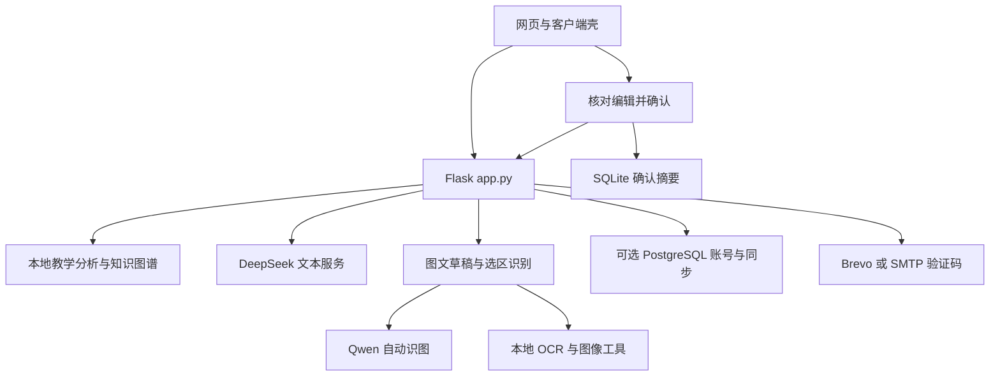

# 系统架构

DMate 是 Flask 提供网页和 API、浏览器保存学习状态的离散数学辅学应用。Android WebView 与 Tauri 桌面壳加载同一远程站点；客户端更新与服务器业务部署分别管理。

## 代码入口与职责

| 位置 | 职责 |
| --- | --- |
| `app.py` | HTTP 路由、参数校验、账号、同步、识别与教学服务编排 |
| `templates/index.html`、`static/script.js` | 页面、聊天、题目状态、学习记录和工作区交互 |
| `static/graph-editor*.js` | 图结构模型、编辑、原图叠加和格式转换 |
| `static/graph-scan-workspace.js`、`static/drawing-workspace.js` | 扫描与独立画板工作区 |
| `static/chat-composer.js`、`static/voice-input.js` | 输入框、多图发送、录音转写 |
| `teaching.py`、`knowledge_graph.json` | 本地教学模式、题目分类、难度与知识依赖分析 |
| `ai.py` | DeepSeek 文本请求、数学格式处理，以及兼容路径的图片理解 |
| `graph_qwen_targeted.py`、`graph_qwen_targeted_review.py` | 网页自动识图及有范围的局部复核 |
| `graph_confirmation.py`、`graph_confirmation_batch.py` | 原图登记、用户确认、快照校验和多图组合 |
| `ocr_runtime.py`、`ocr_worker.py` | 有资源边界的本地 OCR 子进程 |
| `concept_notebook.py`、`drawing_guidance.py`、`voice_input.py` | 概念分析、画图指导和语音转写 |

## 文本教学与出题

前端提交当前题目和本轮请求，`/chat` 清洗消息后由 `teaching.py` 分析，再请求文本模型。主要模式是提示、完整解析、概念讲解、练习出题和答案诊断。题目难度与知识点由规则估计，不是数学正确性证明。

当前文本提供方为 DeepSeek，模型由 `DEEPSEEK_CHAT_MODEL` 设置，默认 `deepseek-flash`。简单题通常使用 `none` 思考强度，中等和困难题使用 `high`；出题首次生成使用非思考路径。普通输出预算由 `DEEPSEEK_MAX_OUTPUT_TOKENS` 控制，`high` 预算由 `MEDIUM_MAX_OUTPUT_TOKENS` 控制。代码不支持 `max` 思考强度。

普通聊天最多处理最近 32 条消息，单条最多 6000 字符。确认图片结构时使用更大的消息边界，并把完整结构单独交给受限图算法和文本服务。部分明确题型还会经过本地精确计算或答案一致性检查；这些检查只覆盖代码支持的范围。

出题请求使用 `request_kind: "exercise"`，可携带参照题。后端重新分析生成题的完整性、模块、核心知识点和难度。未指定难度时普通出题以中等为目标；错题复测可继承已存难度。显式难度偏离时最多补充生成一次，仍可能保留有效但难度估计不同的题。初次正文是否展示答案由本轮要求决定，响应可另外携带参考答案供后续使用。

## 图片、图结构与确认

当前网页自动上传显式发送 `workflow=auto_graph`，调用 Qwen `qwen3.8-flash` 生成可编辑的题干与图结构。OpenCV 点线候选用于触发局部视觉复核；结构校验检查字段、端点和引用。自动识别不会直接开始解题。模型、工具和程序检查均不能代替用户核对原图。

`workflow=manual_graph` 只验证并登记原图，返回手工编辑草稿。文字选区、图形选区和图类型扫描分别调用独立接口。详细路由、模型与资源边界见 [识别流程](RECOGNITION.md)。

确认时，服务端把浏览器身份、原图摘要、请求 ID、文档摘要、修订号和令牌摘要绑定起来，SQLite 只保存这些标识。`/chat` 再核验客户端携带的完整快照；编辑内容后必须重新确认。一次可按用户顺序提交 1–4 张已确认图片，每张独立核验，再组合为本轮上下文。

`DMATE_GRAPH_NEXTGEN` 与 `DMATE_GRAPH_PIPELINE` 控制未显式指定网页工作流时的兼容入口；其中 `agent-tools` 实际调用 `graph_fast_pipeline.py`。仓库中的 strict 多角色、staged 和 evidence 模块仍被部分代码路径引用，不能根据文件名推断它们是网页当前自动识图主线。

## 学习状态与持久化

前端负责会话、题目索引、错题、知识学习记录、概念笔记、画板与外观状态。游客主要使用当前页面内存状态；登录后使用本机缓存并通过 `/sync` 同步。具体数据与清理方式见 [安全与隐私](SECURITY_PRIVACY.md)。

账号与云同步使用可选 PostgreSQL：

| 表 | 内容 |
| --- | --- |
| `dm_users` | 账号、已验证邮箱、密码及恢复码哈希、会话版本 |
| `dm_user_data` | 用户同步 JSONB、递增 revision、更新时间 |
| `dm_email_codes` | 验证码摘要、用途、到期、尝试和消费状态 |

登录使用 Flask 签名的 HttpOnly Cookie。密码和恢复码使用 `scrypt`；验证码使用含服务密钥的 HMAC 摘要。数据库或必要认证配置缺失时，账号功能不可用，游客功能可继续运行。

同步采用 revision 比较后更新。写入携带 `baseRevision`，不匹配返回 409 及当前云端快照，客户端合并后重试。服务端不支持强制覆盖。读取可先查询 revision 或分段摘要，再按同一 revision 拉取所需部分。单份同步 JSON 上限 12 MiB。

## 附加服务边界

概念分析只接收本次选中的笔记，返回解释和关联，不修改原笔记。画图指导只接收当前画图快照和要求，返回文字建议；上传画图则验证 PNG 与结构，不重新识别图片内容。语音接口默认调用 `qwen-audio-3.1-asr-flash`，返回文字到输入框，发送聊天由用户另行操作。

## 运行与维护

部署命令、环境变量及模型缓存见 [部署说明](DEPLOYMENT.md)，字段约定见 [API](API.md)。构建依赖以 `requirements.txt`、`requirements-agents.txt` 和各客户端构建文件为准。

限流、活动识别任务和取消标记保存在 Web 进程内，当前部署应保持单 worker、多线程。确认摘要使用 SQLite 事务，可由同机 worker 共享；它不使其余进程内状态自动共享。扩展 worker 或副本数量前，需要统一限流、取消、任务容量和确认存储。

`/health` 表示 Web 能响应并附带源文件摘要与识别配置；`/ready` 展示本地 OCR 和兼容识别状态。它们不会主动调用远程模型，也不能证明当前网页 `auto_graph` 识别正确。修改识别路径时应同步检查网页提交的 `workflow`、实际调用模块和诊断字段，避免把兼容入口的健康信息当作网页主链结果。

维护时先确认改动涉及的入口、结构字段及持久化格式；前后端共享字段应同时更新。可离线检查 Python 语法、JavaScript 语法、JSON 格式和文档链接。涉及网络、模型或发布的结果，应明确说明实际执行范围与限制，不根据历史记录宣称当前版本已验证。
