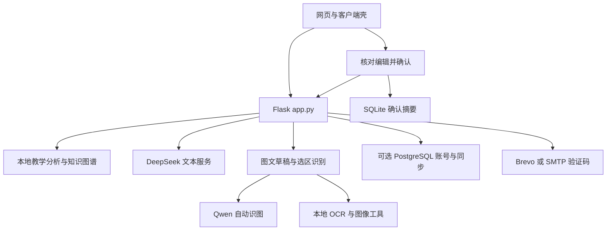
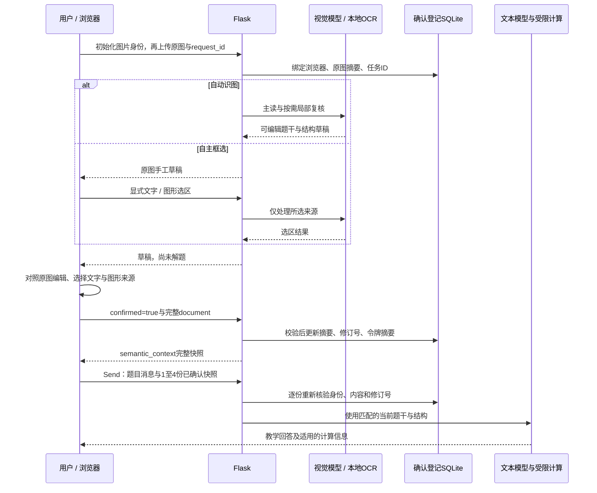

# 系统架构

DMate 是 Flask 提供网页和 API、浏览器保存学习状态的离散数学辅学应用。Android WebView 与 Tauri 桌面壳加载同一远程站点；客户端更新与服务器业务部署分别管理。

## 系统的四层边界

| 层 | 负责的内容 | 不负责的内容 |
| --- | --- | --- |
| 浏览器 / WebView | 工作区展示、编辑草稿、对话与学习记录、题目标记、图片分组、本机绘图库 | 不持有模型 API Key，不自行签发已确认结构 |
| Flask 业务层 | 参数和身份校验、请求编排、题目上下文、服务限流、同步、确认结构绑定 | 不以“模型说完整”作为原图准确性认证 |
| 本地受限处理 | OCR 子进程、OpenCV 图像候选、结构检查、明确题型的数学计算 | 不读取任意聊天替代本轮原图，不执行用户给出的程序代码 |
| 外部服务 | DeepSeek 文本、Qwen 视觉 / 语音、邮件、PostgreSQL 持久化 | 服务之间不共享同一套状态，某一服务可用不能证明其他服务可用 |

主页面由 Flask 模板直接输出，再加载原生 JavaScript 和 CSS。没有需要先运行的 Node 前端编译服务。Python 依赖、浏览器代码和客户端壳是三个独立维护面，修改网页业务通常不要求重编译 APK / Tauri；修改原生权限和桥接逻辑则需要重新构建客户端。

## 代码入口与职责

| 位置 | 职责 |
| --- | --- |
| `app.py` | HTTP 路由、参数校验、账号、同步、识别与教学服务编排 |
| `templates/index.html`、`static/script.js` | 页面、聊天、题目状态、学习记录和工作区交互 |
| `static/graph-editor*.js` | 图结构模型、编辑、原图叠加和格式转换 |
| `static/graph-scan-workspace.js`、`static/drawing-workspace.js` | 扫描与独立画板工作区 |
| `static/chat-composer.js`、`static/voice-input.js` | 输入框、多图发送、录音转写 |
| `teaching.py`、`knowledge_graph.json` | 本地教学模式、题目分类、难度与知识依赖分析 |
| `ai.py` | DeepSeek 文本请求、数学格式处理，以及兼容路径的图片理解 |
| `chat_limits.py` | 普通消息、内部题目包装、已确认图片与历史预算的共享边界 |
| `graph_qwen_targeted.py`、`graph_qwen_targeted_review.py` | 网页自动识图及有范围的局部复核 |
| `graph_confirmation.py`、`graph_confirmation_batch.py` | 原图登记、用户确认、快照校验和多图组合 |
| `ocr_runtime.py`、`ocr_worker.py` | 有资源边界的本地 OCR 子进程 |
| `ocr_text_engine.py` | 本地文字 ONNX / 显式 Paddle 回退的引擎配置与模型路径 |
| `concept_notebook.py`、`drawing_guidance.py`、`voice_input.py` | 概念分析、画图指导和语音转写 |

一些维护时常用的补充入口：

| 位置 | 关注点 |
| --- | --- |
| `static/graph-editor-model.js` | 图结构变更、撤销 / 重做、顶点与边的模型状态 |
| `static/graph-editor-format.js` | 图形信息、位置和结构的展示格式 |
| `static/drawing-export.js` | 画板输出与图片导出 |
| `static/mobile-select.js`、`static/delete-confirm.js` | 移动端选择弹窗、共享删除确认 |
| `static/concept-notebook-model.js`、`static/concept-notebook.js` | 概念笔记的规范化、编辑与选中分析 |
| `static/learning-report.js` | 依据当前学习数据，在本地生成学习回顾的三段概要，不调用模型或另建评分数据库 |
| `static/web-sync.js` 与 `static/script.js` 的同步逻辑 | 快照、版本、跨设备读取与合并 |
| `graph_upload_tasks.py`、`graph_local_scheduler.py` | 活动图片准入及本地推理调度 |
| `image_upload_limits.py`、`image_evidence.py` | 字节 / 像素限制、图像解码和传输副本 |
| `graph_schema.py`、`graph_presentation.py` | 图结构格式、命名与可读展示 |
| `graph_semantic_solver.py`、`graph_exact_solver.py`、`dmate_math_tools.py` | 已确认结构的受限计算与答案辅助 |
| `runtime_source_identity.py` | 运行源码摘要与识别预算诊断 |
| `desktop/src-tauri/`、`android/` | 桌面和 Android 原生壳 |

## 文本教学与出题

前端提交当前题目和本轮请求，`/chat` 清洗消息后由 `teaching.py` 分析，再请求文本模型。主要模式是提示、完整解析、概念讲解、练习出题和答案诊断。题目难度与知识点由规则估计，不是数学正确性证明。

当前文本提供方为 DeepSeek，模型由 `DEEPSEEK_CHAT_MODEL` 设置，默认 `deepseek-flash`。简单题通常使用 `none` 思考强度，中等和困难题使用 `high`；出题首次生成使用非思考路径。普通输出预算由 `DEEPSEEK_MAX_OUTPUT_TOKENS` 控制，`high` 预算由 `MEDIUM_MAX_OUTPUT_TOKENS` 控制。代码不支持 `max` 思考强度。

普通输入单条最多 20,000 字符，历史最多 64 条消息、合计 120,000 字符。前端普通历史回退窗口同为 64 条；新题和已有题目的追问仍按题目范围发送，避免混入其他题。当前题、最新请求及最近相关回答优先保留，预算不足时丢弃较早的完整消息，不切掉当前题条件。题干缓存保留至 28,000 字符，以兼容已确认图片；答案、笔记和解析的独立边界不随输入扩容改变。

内部“当前题干 + 本轮请求”与复测检查包装另设 42,000 字符总界限，并校验题干、用户本轮文字各不超过 20,000 字符，不借内部包装开放任意超长普通输入。已确认图片请求仍为单条 28,000 字符，并把完整结构交给受限图算法和文本服务。部分明确题型还会经过本地精确计算或答案一致性检查；这些检查只覆盖代码支持的范围。

字符数不冒充模型精确 token 数。文本服务仅在提供方明确报告上下文容量错误时，最多额外重试一次缩减历史；系统消息、当前题、最新请求及续写 / 格式恢复的必要原始内容保留。其他 400 不触发此重试，必要内容本身仍超限时明确报错，不截断条件。此次不改变文本模型、输出 token 预算或图片传输限制。

出题请求使用 `request_kind: "exercise"`，可携带参照题。后端重新分析生成题的完整性、模块、核心知识点和难度。未指定难度时普通出题以中等为目标；错题复测可继承已存难度。显式难度偏离时最多补充生成一次，仍可能保留有效但难度估计不同的题。初次正文是否展示答案由本轮要求决定，响应可另外携带参考答案供后续使用。

### 消息、题目与学习记录不是同一个对象

一条聊天消息可以是题干、追问、概念讨论或普通闲聊。前端的“题目：是 / 否”决定是否把本轮内容收录为正式题目记录；追问仍可沿用当前题目上下文。图片工作区的分组是在发送前把一个或多个来源组成一道题，再给该组设置题目标记。它不把所有上传图片强制变成独立题目，也不改变原图各自的确认身份。

正式题目记录驱动知识索引，并为学习回顾提供内容来源；错题本是用户另行加入并维护的订正记录。删除对话会同步移除该对话产生的学习统计，已经加入错题本的记录有自己的数据对象，不因对话删除被一并销毁。概念笔记和独立绘图同样有各自的数据边界。

异步请求在发起时保留目标会话、用户消息及任务身份。收到回答后再次检查目标是否仍是相同对象；图片发送还检查当前任务与确认快照。历史分类、错题答案和分析也需要核对原记录是否仍存在、题干是否已修改，避免把晚到的结果写入另一道题。

## 图片、图结构与确认

当前网页自动上传显式发送 `workflow=auto_graph`，调用 Qwen `qwen3.8-flash` 生成可编辑的题干与图结构。OpenCV 点线候选用于触发局部视觉复核；结构校验检查字段、端点和引用。自动识别不会直接开始解题。模型、工具和程序检查均不能代替用户核对原图。

`workflow=manual_graph` 只验证并登记原图，返回手工编辑草稿。文字选区、图形选区和图类型扫描分别调用独立接口。详细路由、模型与资源边界见 [识别流程](RECOGNITION.md)。

确认时，服务端把浏览器身份、原图摘要、请求 ID、文档摘要、修订号和令牌摘要绑定起来，SQLite 只保存这些标识。`/chat` 再核验客户端携带的完整快照；编辑内容后必须重新确认。一次可按用户顺序提交 1–4 张已确认图片，每张独立核验，再组合为本轮上下文。

### 从原图到回答的状态流

已核对卡片仅保留“已核对”和“编辑”，原图缩略图和移除控件仍用于辨认与管理任务。题干、点边关系和用户实际填写的可选要求仍保存在任务中，点击“编辑”重新查看。保存不会自动发送；用户未填写要求时，不生成“我的要求”或默认替用户指定解题目标。

发送准备与等待 AI 回答期间，前端收起图片工作区，恢复普通聊天输入框，并保留红色停止按钮。任务在各自发送成功后才清除；停止或失败时，未完成的任务可回到图片工作区继续处理。停止浏览器请求与向识别检查点登记取消是不同机制，均不能当作上游服务已终止计费的证明。

### 文档与展示坐标

`document` 由 `body_text` 和 `graphs` 构成。每幅图独立保存顶点与边实例，边使用顶点 ID 引用端点；`weight` 是权值，`edge_label` 是边名。无名节点通过临时 `display_label` 指代，不把临时编号伪装成原图标签。重边是多条独立记录，自环的两个端点引用同一节点。

数学语义结构和绘图布局分开保存。顶点 `x/y`、边 `path`、图区域与外观文字用于还原和说明布局；连线在画面中相交不会自动变成图论顶点。独立画板可按实际位置补充位置描述和当前外观，扫描原图已有的描述则应保留。结构规范化不会用屏幕距离猜测缺失的端点、箭头或权值。

多图组合由 `graph_confirmation_batch.py` 建立各图的来源命名空间，保留图片顺序和每张原始身份；它不是签发一份可以替代所有原始令牌的新图片确认。批次中任一确认失效，客户端需修复相应图片，不能借用其他图片的确认继续。

`DMATE_GRAPH_NEXTGEN` 与 `DMATE_GRAPH_PIPELINE` 控制未显式指定网页工作流时的兼容入口；其中 `agent-tools` 实际调用 `graph_fast_pipeline.py`。仓库中的 strict 多角色、staged 和 evidence 模块仍被部分代码路径引用，不能根据文件名推断它们是网页当前自动识图主线。

## 学习状态与持久化

前端负责会话、题目索引、错题、知识学习记录、概念笔记、画板与外观状态。游客主要使用当前页面内存状态；登录后使用本机缓存并通过 `/sync` 同步。具体数据与清理方式见 [安全与隐私](SECURITY_PRIVACY.md)。

账号与云同步使用可选 PostgreSQL：

| 表 | 内容 |
| --- | --- |
| `dm_users` | 账号、已验证邮箱、密码及恢复码哈希、会话版本 |
| `dm_user_data` | 用户同步 JSONB、递增 revision、更新时间 |
| `dm_email_codes` | 验证码摘要、用途、到期、尝试和消费状态 |

登录使用 Flask 签名的 HttpOnly Cookie。密码和恢复码使用 `scrypt`；验证码使用含服务密钥的 HMAC 摘要。数据库或必要认证配置缺失时，账号功能不可用，游客功能可继续运行。

同步采用 revision 比较后更新。写入携带 `baseRevision`，不匹配返回 409 及当前云端快照，客户端合并后重试。服务端不支持强制覆盖。读取可先查询 revision 或分段摘要，再按同一 revision 拉取所需部分。单份同步 JSON 上限 12 MiB。

### 存储按用途分开

| 状态 | 生命周期 / 保存位置 | 是否随账号云同步 |
| --- | --- | --- |
| 进行中的模型请求与图片草稿 | 页面内存与进程内任务状态 | 否 |
| 游客聊天、错题、笔记及学习状态 | 当前页面 | 否 |
| 登录用户学习快照 | 本机缓存与 PostgreSQL JSONB | 是，依赖成功同步 |
| 账号独立绘图库 | 当前浏览器 localStorage，按账号分区 | 否 |
| 游客独立绘图 | 当前页面内存，同页重开绘图弹窗可复用；刷新 / 关闭网页后清空 | 否，不写 localStorage 或 sessionStorage |
| 自定义背景原图 | 当前浏览器 IndexedDB | 否；外观参数与图片二进制分开 |
| 原图来源和确认记录 | 服务端 SQLite 的身份及摘要，有期限 | 不属于用户云同步正文 |
| 内置知识图谱 | 仓库 `knowledge_graph.json` | 固定课程资源，不是个人掌握度模型 |

学习回顾综合当前存在的题目与聊天学习事件、错题状态、概念笔记及当前身份的非空画板，使用本地规则派生摘要。画板来自活动绘图工作区、账号本机图库或游客页面内存；收集时不新建画板、不写入存储，也不读取其他身份的图库。笔记和画板不会因存在聊天记录而被忽略。完全无内容时正文仅显示“无”；有内容时采用“最近学习”“值得再看看”“接下来可以做”三个纵向模块，缺乏依据的模块显示“无”。不展示数字面板、评分、档案、筛选或快捷按钮，也不调用模型。正式题目标记、图片分组和知识图谱的题目索引仍保持独立生效。

绘图工作区由调用方明确区分持久化模式：已登录账号可读写本机图库，游客使用页面内 `sessionState` 保留当前页的多画板状态；关闭 / 销毁绘图弹窗不会结束页面内工作区，刷新或关闭网页才清空。游客路径不使用 sessionStorage，旧版游客图库键及无归属 / 游客旧画板持久数据会被清理，不导入临时状态。

知识图谱的普通索引走本地分类；错题旧记录的特定语义补分类可显式启用模型复核，两者应在文档和隐私说明中区分。

完整本机 / 云端快照之外，同步还支持 revision-only、manifest-only 和指定分段读取。分段请求带 `expectedRevision`，防止读取过程中云端更新导致把不同版本的部分拼成同一份快照。冲突后的合并在客户端进行，不提供绕过 revision 的服务端强制写入。

## 附加服务边界

概念分析只接收本次选中的笔记，返回解释和关联，不修改原笔记。画图指导只接收当前画图快照和要求，返回文字建议；上传画图则验证 PNG 与结构，不重新识别图片内容。语音接口默认调用 `qwen-audio-3.1-asr-flash`，返回文字到输入框，发送聊天由用户另行操作。

这些功能各有输入和资源上限：笔记分析最多选择 12 条，关联分析至少 2 条；绘图指导最多 16 幅图并限制顶点 / 边总量；语音最多 60 秒。它们不自动读取所有历史笔记、所有绘图页或其他会话。使用共享模型提供方不表示共享相同的业务提示和权限范围。

## 本地推理与任务资源

网页 HTTP 线程负责接收和编排，不把 ONNX 或 Paddle 模型常驻在 Flask 进程内。`ocr_runtime.py` 准备输入、选择可写模型缓存、启动短生命周期 worker，读取有上限的结果文件，并核对本次运行的回执。`ocr_worker.py` 完成本次模型阶段；崩溃、超时或内存异常由父进程处理，避免把同一原生推理错误直接带入 Web 进程。

本地文字阶段默认用 ONNX Runtime CPU 执行 PP-OCRv6 Small 检测与识别，继续使用 PaddleOCR / PaddleX 的前后处理；PP-DocLayoutV3 版面阶段仍使用 Paddle。`ocr_text_engine.py` 只选择已准备的模型及执行配置，不在请求中转换模型。构建时由官方 Paddle 权重导出文字 ONNX 并核对清单，保留原包供显式回退。`DMATE_TEXT_OCR_ENGINE=paddle_static` 选择原执行路径；默认 `onnxruntime`，异常不隐式降级。

模型阶段由本地调度器串行租约约束。DocLayout 与文字 small 模型不在同一个 worker 中并存；远程视觉请求不占本地推理租约。内存判断考虑 worker RSS、cgroup 剩余空间及保守的可回收文件缓存估计。`ocr_worker_audit.py` 是运行时回执与资源审计代码，属于生产路径，不能按文件名当作测试工具删除。

图片上传准入当前上限为 4 个活动原图 / 图形选区任务；同一浏览器重复的活动任务 ID 被拒绝。它与“前端一次最多 4 张”、每分钟频率限制、本地模型租约分别解决不同问题，不能互相替代。

## 运行与维护

部署命令、环境变量及模型缓存见 [部署说明](DEPLOYMENT.md)，字段约定见 [API](API.md)。构建依赖以 `requirements.txt`、`requirements-agents.txt` 和各客户端构建文件为准。

限流、活动识别任务和取消标记保存在 Web 进程内，当前部署应保持单 worker、多线程。确认摘要使用 SQLite 事务，可由同机 worker 共享；它不使其余进程内状态自动共享。扩展 worker 或副本数量前，需要统一限流、取消、任务容量和确认存储。

`/health` 表示 Web 能响应并附带源文件摘要与识别配置；`/ready` 展示本地 OCR 和兼容识别状态。它们不会主动调用远程模型，也不能证明当前网页 `auto_graph` 识别正确。修改识别路径时应同步检查网页提交的 `workflow`、实际调用模块和诊断字段，避免把兼容入口的健康信息当作网页主链结果。

维护时先确认改动涉及的入口、结构字段及持久化格式；前后端共享字段应同时更新。可离线检查 Python 语法、JavaScript 语法、JSON 格式和文档链接。涉及网络、模型或发布的结果，应明确说明实际执行范围与限制，不根据历史记录宣称当前版本已验证。

常见改动的追踪顺序：

| 修改目标 | 先追踪的调用链 |
| --- | --- |
| 自动识图结果不正确 | 网页实际 `workflow` → `/ocr` 分支 → targeted 主读 / 局部复核 → 可编辑草稿 |
| 核对保存后不能发送 | 前端任务确认状态 → `/graph/confirm` → SQLite 身份与修订号 → `/chat` 快照核验 |
| 某条边显示与解题不一致 | 编辑模型 → 文档转换 → 确认规范化 → 语义计算中的边实例 |
| 学习回顾内容不符 | 题目标记与图片分组 → 会话题目索引 → 学习状态 → 本地概要规则 |
| 多设备内容回退 | 用户身份 → 本机快照 → revision / manifest → 冲突合并及重试 |
| 移动端属性面板误点 | 画板事件 → 面板布局 → `mobile-select.js` 手势来源与原生 dialog 层级 |

仓库当前不保留历史测试集、付费识别基准和诊断页面。维护时可按变更范围做必要的本地检查；重新建立测试目录、运行付费模型或生产探测不是启动服务或编写文档的前置条件。
