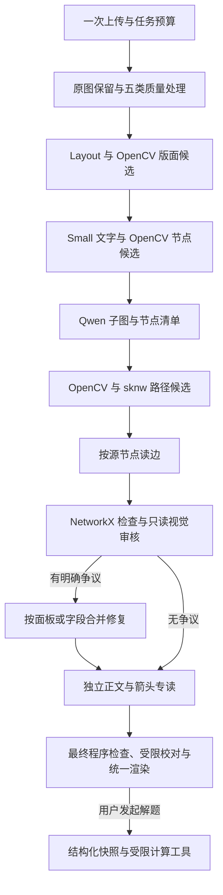

# DMate 图论图片识别统一架构

版本：2026-10-26，semantic-v3 工具与视觉协同实现。本文为现行架构入口；V3 已接入开发代码，仍待完整工程门、合入、部署及真实上传验收，线上仍为 V2。

## 0. 先区分目标架构与已经实现的能力

本设计覆盖用户上传原图后的图文识别、内部复核、统一展示以及向解题模块交付输入。目标是用户上传一次，应用在同一任务中完成必要的工具分析与模型复核。用户提供的 86 张原图是当前完整回归范围。

**验收目标是题意和图结构正确。精确坐标、曲线重绘、逐边证明字段不作为用户内容通过条件。放宽几何验收，不意味着停用几何算法。** OpenCV、版面模型和骨架工具仍应实际提供定位、候选和局部复核依据。

| 状态 | 截至本文编写时的事实 |
| --- | --- |
| 最近核验的线上版本 | `2026-10-26-agent-semantic-v2`，对应 main `8593917bad0136a3b8aec99cd69566e5b6c2bfe8`；该版本的部署和六张原图首响应已核对 |
| 线上主链 | Qwen 节点清单 → GLM 按源读边 → Qwen 整体复核 → 条件式 GLM 修复 → 受限 DeepSeek 文字校对 |
| 线上工具缺口 | 原图与 OpenCV 辅助图已使用，但没有调用 Layout/Small worker，也没有让节点、OpenCV 路径和 sknw 候选进入语义主链 |
| 当前开发 | semantic-v3 已接入 Layout、Small、OpenCV/sknw、NetworkX 注册工具、只读视觉审核、字段范围合并、独立正文与方向读取，以及结构化快照解题；正在完成工程验证，尚未合入或部署 |
| V2 实图结果 | 最近六张：人工可见语义 3 通过、3 失败；其中一张通过有格式提示，一张内容正确但程序标记 partial。不能据此宣称全部 86 张通过 |
| 本文性质 | 当前开发实现与审查依据；开发代码、工具实测、工程测试和线上内容准确率分别记录 |

旧 `GRAPH_VISION_ARCHITECTURE.md`、`GRAPH_EVIDENCE_ARCHITECTURE_20261026.md`、`DMATE_TOOL_AGENT_ARCHITECTURE_20261026.md` 保留历史设计和测试记录。旧文中的固定两次 Qwen、默认不跑 sknw、早期全像素证明门等规定不再是本架构的现行约束。不能把不同版本的成功记录拼成当前版本的通过记录。

## 1. 固定的技术组合

| 类别 | 选用组件 | 固定职责 |
| --- | --- | --- |
| 应用内编排 | LangGraph + DMate 本地工具注册器 | 管理阶段、依赖、并行、预算、取消和局部返工；无需模型决定每一次工具调用 |
| 版面 | PP-DocLayoutV3 + OpenCV 留白/轮廓/投影分析 | 提出正文、图注、图形区域及数学子图候选 |
| 文字候选 | PaddleOCR PP-OCRv6 Small | 提供正文与标签的转录和位置，按需使用，保留原识别与来源 |
| 图像处理 | OpenCV + Pillow + NumPy | 安全解码、方向、透明度、颜色、背景、弱墨迹、模糊诊断和原图裁切 |
| 几何提取 | OpenCV 节点检测、自有追踪器、sknw | 原像素节点、直线/弧线/骨架链、箭头和独立笔画候选 |
| 视觉理解 | Qwen3-VL-Plus、GLM-5V Turbo | 数学子图归属、节点语义、按源读边、复杂局部和属性复核 |
| 结构核对 | 语义 schema + NetworkX | 检查引用、独立边实例、方向和属性的一致性；不从数学性质倒推图 |
| 文字校对与解题 | 当前配置的 DeepSeek | OCR 后做受限制的文字校对；用户另行发起解题时处理推导与解释 |
| 计算工具 | NetworkX 的语义图适配器；已有 SymPy 受限接口 | V3 将明确请求的图算法接入统一语义结构；已有逻辑/矩阵工具继续保留，不宣称所有数学题已自动路由 |
| 回归 | 原图、独立人工参考、真实 /ocr 响应、浏览器展示 | 验证一张原图一次上传得到的完整结果 |

这里的插件是 DMate 服务内部的工具适配器。已有本地函数通过注册器接入即可；不要求先包装成远程 MCP 服务，也不为同一任务同时加入多个智能体编排框架。LangGraph 支持组合确定性步骤与模型步骤，本项目采用显式工作流。[R1]

## 2. V3 已接入的流程

下图对应本轮开发代码的阶段关系。工具可以失败或无结果；运行状态和未确定项继续传递，不能因流程走完便宣称原图识别正确。

本地重工具共享锁；节点清单先于按源读边。远程任务最多两路，末段正文专读与方向专读可以并行。只有出现指定争议才启用对应修复范围，未经授权的面板和字段保留。解题由用户另行启动，计算结果不能反向改写识别输入。

## 3. 五类图像问题必须怎样处理

### 3.1 颜色

保留全尺寸 RGB 原图；亮度分析与颜色分析分开。OpenCV 的 HSV、Lab 与通道对比提供彩色墨迹候选，避免浅红、浅蓝细边在灰度阈值下消失。暗底亮线、透明底、彩色纸张和 PPT 背景分别记录处理状态。[R2]

颜色分析必须绑定到具体笔画或图形对象，不能把红色文字当红边。节点颜色与边颜色分开。最终保存有意义的颜色类别；普通黑色和显示默认颜色允许等价，红蓝互换不能忽略。增强图的颜色变化不替代原图颜色。

### 3.2 透印

建立强墨迹、与强墨迹相连的弱笔画、其余弱墨迹三个辅助层。保留所有原图像素，限制弱纹理在接触一处强笔画后扩散为整页有效墨迹。强弱阈值和滞后连接只产生候选，不凭浅灰颜色判定背面透印。[R3]

正面浅线、细虚线和背面透印可能相似。结合版面归属、局部线迹、文字方向和原图复核决定是否属于题目；证据不足时保留局部疑点。当前没有能够保证单面照片前后景彻底分离的专用恢复模型。

### 3.3 模糊

用 Laplacian、Sobel 梯度、局部对比及笔画连续性做质量诊断。优先从全尺寸原图裁出小字、箭头和边交叉区；必要时提供有限锐化与放大副本。所有辅助图保留原图映射。

锐化提高可见性，但不等于恢复已经丢失的细节。不能使用锐化或生成式修复新增的尖端、数字和线条作为唯一依据。DocRes、文字盲去卷积等保留为研究和后续实验项，本轮不默认加载重型恢复网络。[R4][R5]

### 3.4 分图

先实际执行 PP-DocLayoutV3，获得图、正文、图注等版面区域；再用 OpenCV 留白投影、轮廓分组和相邻元素位置提出细分候选。Layout 失败或把多个图合进一个框时，CV 候选和全页原图继续可用。[R6]

候选只是区域建议：一幅非连通数学图可含多个墨迹块，一个版面 image 框也可含多个数学子图。结合 (a)/(b)、G₁/G₂ 等图注与原图确定数学子图。图注不能当节点，也不能用“欧拉图”等文字反推边。

裁图保留宽松边缘，包含外弧、自环、孤立点和图注。总览始终随局部图一起提供。内部保留父区域、原图范围和裁图映射，但不要求模型精确复述矩形坐标。

一次视觉输入的局部图数量有上限，不代表页面最多支持四幅数学图。超过当前四张页面局部的部分应记录未放大项，并在后续对应面板/源任务中补送局部；全页图和完整候选清单始终保留，不能静默丢掉第五幅及后续子图。

### 3.5 阴影

用低频背景估计、局部对比和颜色感知归一化减轻不均匀照明。形态学闭运算用于估计纸张背景，不把闭运算连接起来的笔画直接提交成边。阴影边界、桌面纹理和装饰图案仍需要版面归属判断。[R7][R8]

同一区域同时保留原图和归一化视图。两者发生连接关系变化时，回查原图局部；它们来自同一张图片，不能当作两次独立投票。浅色边不因阴影处理而自动删除。

## 4. 版面与文字：Layout 和 Small 都有明确位置

### 4.1 Layout 输出

输出区域 ID、粗略范围、类别、来源和执行状态，并提供原图裁片。布局来源要区分：本次 PP-DocLayoutV3 推理、复用已有结果、OpenCV 候选。三者不能混称为本次模型执行成功。

初始节点读取实际收到这些候选；按源读边优先使用匹配的面板裁片；题干专读使用正文区域提示。这样 Layout 的结果会影响输入组织，而不只是写进日志。

### 4.2 PaddleOCR Small 的职责

现有代码的文本模型为 `PP-OCRv6_small_det` 与 `PP-OCRv6_small_rec`，沿用 Small，不新增第二套重型文字模型。V3 在节点清单读取前实际调用 `prepare_semantic_text`：优先复用同次原图的有效文字结果，否则在本地缓存齐备时启动独立 text worker；缺缓存明确跳过，不在请求中隐式下载模型。纯图也可能有需要读取的节点名或边名，不能仅因题干为空就认定没有文字任务。

Docker 构建通过 `scripts/prepare_ocr_model_cache.py` 提前准备这两个 Small 模型和 `PP-DocLayoutV3`，默认缓存目录由镜像设置，无需用户另添环境变量。脚本只调用官方模型包下载接口，不初始化推理网络；核验模型声明名称和三份推理文件，并保存摘要记录。该层位于完整业务源码复制之前，普通代码修改可复用模型层。下载或核验失败会明确使构建失败。已有三包真实缓存约 163.5 MB 的离线校验已通过；实际冷构建与新部署仍须验证。

Small 给出候选文字及位置，视觉角色对原图确认正文归属、上下标、负号、数字和边权。图内标签分别进入节点标签、边名和权值，不拼成题干。公式以原图转录形成可渲染数学表达；本轮不要求每次额外启动独立公式网络。

**实施状态：线上 V2 跳过 Small，开发 V3 已接入。** 独立本地原图测量得到 21 条文字候选、工具耗时约 9.10 秒；这是本地工具执行证据，未调用付费视觉模型，不是最终文字准确率。该阶段上限约 18 秒，与 Layout、sknw 共用本地重任务锁。复用结果带来源说明；只有尺寸相符而没有摘要的旧调用方结果，不冒称已经通过原图 SHA 绑定。Small 失败或未执行不会抹掉视觉正文，失败原因继续留在诊断中。

### 4.3 DeepSeek 的修改边界

识别阶段 DeepSeek 接收已有文字，不接收图片。只允许能够通过原文锚定和等义检查的字形、空白修正；不能猜改数字、变量、数学符号、否定词、数量关系或补齐被裁掉的句子。调用失败或无安全修改时保留原转录。

同一个 DeepSeek 服务在解题阶段承担另一种任务。识别校对和数学解题使用独立输入、提示及输出边界。

## 5. 几何提取：OpenCV、自有追踪器与 sknw

### 5.1 节点候选

OpenCV 通过实心圆点、空心圈、轮廓层级、径向支持和必要的圆检测提出节点候选。文字中的圆孔、数字笔画、箭头尖、普通交叉点不直接成为数学顶点。[R9]

Qwen 使用原图、版面候选和这些节点提示建立数学节点清单。没有圆点但明确用标签或线端表示的节点仍可保留。匿名点使用内部 ID，印刷标签另存。粗位置可辅助关联 CPU 标记；无法唯一关联时保留未关联候选，不能判整图失败。

### 5.2 文字干扰

文字框可以帮助识别路径上的字形干扰，但不得直接从唯一原图删除文字区域。节点标签或权值可能覆盖连线；需要保留原图及候选遮罩，结合两端走向判断。正文、图注、边名和权值分别归属，不能用全局正则清除数字。

### 5.3 路径候选

沿用实际 OpenCV/自有追踪代码：

- Guo–Hall 细化与骨架备用路径；
- Hough 线段、圆周附近的端点附着；
- 从节点端口出发的切线连续追踪；
- 曲线路径与外绕弧候选；
- 普通交叉处保持原线方向，不凭交叉新增节点；
- 断裂、长空白和中途真实节点检查；
- 独立平行笔画与自环候选。

OGR 提供“分割后恢复节点附着及交叉连接”的方法框架；FlowExtract 提供图元检测与连通性恢复分离的参照。当前代码是自有实现对这些思想的借鉴，不能说已经复现或完整安装了论文系统。[R10][R11]

### 5.4 sknw

sknw 实际接收骨架，输出带路径的像素网络；使用支持多边和环的配置，保留不同路线实例。它补充自有追踪器的候选，不替换数学节点清单。[R12]

必须注意三点：

1. 骨架交叉节点不自动成为数学顶点；纯环插入的工具节点也不是题目新顶点。
2. sknw 的 `weight` 是几何长度，不能写入题目印刷权值。
3. 没有候选不证明没有边；同一笔画被 OpenCV 与 sknw 同时找到，也不能算两条平行边。

每条候选保存工具来源、局部原图范围、路径实例和端点关联状态。能够唯一对应数学节点才填写语义端点，否则保持未关联，并交给局部视觉任务确认。

### 5.5 箭头

OpenCV 测量实心箭头的宽度变化、两翼与尖端，以及空心箭头的成对轮廓和共同尖端；方向要结合该条路径的切线。箭头可能位于边中段，不能只检查节点附近。

测量绑定到独立路径实例。同一对节点有两条弧时，不能把一条弧的箭头套给另一条。没有检测到箭头表示工具没有给出结论，不能直接改成无向边或删除边。

### 5.6 重边、自环、虚线

按独立笔画实例计边，不按端点对去重。两条同向弧、两条反向弧和自环都要分别保留。粗线的双边缘、空心箭头的两个轮廓、同笔画反向追踪属于重复候选，需要原图对应关系来去重。

虚线本来存在间隔，连续性算法不能把所有间隔判为漏边，也不能用大范围闭运算把不同虚线拼成一条。节点圆圈本身不能充当自环。

## 6. 拓扑理解与多模型分工

采用 Ariadne 的任务拆分思想：先确定节点清单，再按源节点读取边。其论文方法涉及训练和完整的分阶段模型；DMate 借鉴任务组织，不声称复现论文模型或准确率。[R13]

| 角色 | 执行器 | 主要输入 | 可提出的内容 |
| --- | --- | --- | --- |
| 页面与节点角色 | Qwen3-VL-Plus | 全页原图、Layout 区域、OpenCV 节点候选 | 数学子图与节点清单、可见标签、粗位置 |
| 文字角色 | Small + Qwen/GLM 原图读取 | 正文/标签局部、原图、OCR 候选 | 原文转录与字段归属，不描述图结构充当题干 |
| 拓扑角色 | GLM-5V Turbo，Qwen 为明确的接替路径 | 面板原图、节点清单、OpenCV/sknw 路径候选、指定源节点 | 边实例、端点、方向及可见属性 |
| 方向专审 | GLM-5V Turbo，失败时可用 Qwen | 原图放大、独立路径/箭头提示、已有边的无序端点 | 只修改指定边的方向与端点次序 |
| 属性核查 | Qwen/GLM 的窄任务 | 固定边实例、原图局部、文字与颜色提示 | 权值、边名、颜色和线型 |
| 审核协调 | NetworkX 注册工具 + 独立 Qwen 任务 | 原图、语义草稿、工具分歧及任务完成情况 | 程序一致性问题、只读视觉问题列表；不直接替换完整稿 |
| 文字校对 | DeepSeek | 已识别题干 | 受限的等义编辑 |
| 解题 | DeepSeek + NetworkX 语义计算工具 | 用户提交的同一语义快照与明确问题 | 按适用条件计算、推导和解释；已有其它数学工具不自动等于本入口全部接通 |

角色可以共享供应商，但任务输入与可修改字段必须分开。模型之间同意、工具之间同意或同一原图的不同增强视图一致，都不能单独证明正确。

当前逐源读取按最多六个源节点分组；无向边从两端读取后合并，有向边按出边记录，自环在该源下记录一次。工具候选作为观察提示，候选未检出的真实边仍允许读出。

GLM 的思考模式不是准确率开关。当前 v3 草稿对多子图采用较短读取，以免流式推理耗尽后续面板时间；复杂单图可以使用扩展思考。该策略需要真实样本验证，不以供应商宣传替代 DMate 测试。[R14]

## 7. 证据融合怎样真正影响识别

融合器分别保存像素候选、模型读法和已提交语义。工具结果进入三个实际环节：选择模型收到的原图局部、提供候选连接与箭头提示、把分歧变成局部复核任务。

| 观察到的情况 | 动作 | 不采取的动作 |
| --- | --- | --- |
| Layout 与模型的分图不一致 | 查看图注及重叠/遗漏区域，复核相关面板 | 直接用框数覆盖数学图数 |
| CV 路径指向的端点与模型不同 | 提供该路径及两端原图局部，核查连接 | 无条件相信 CV 或模型 |
| 有工具路径但模型没列边 | 核查该候选是否真边或文字干扰 | 自动补边 |
| 模型有边而工具未检出 | 保留模型提议，按原图复核 | 因缺候选直接删边 |
| 同一端点对有多条候选 | 逐笔画对应，区分重复检测与真实平行边 | 把候选数当边数 |
| 箭头测量与读法冲突 | 只复核对应实例或平行边组 | 修改其它边权或节点 |
| 增强前后出现连接变化 | 用原图局部重新观察 | 将增强图当第二张独立证据 |
| 多个读取都一致 | 作为一致性信息，继续必要的内容核对 | 自动生成“正确证书” |

VisAdj 的候选边联合建模提供参考：相邻候选、交叉与共享端点应一起判断。当前采用轻量候选与冲突关系整理；原 VisAdj 的 SAM 编码器、采样器和关系网络没有部署。[R15]

## 8. 局部修复与修改权限

V3 的正常独立审核仅返回问题，不提交整页替代稿。程序依据问题限定后续修复权限；输入尚未形成可读文档时，另有明确的完整读取恢复路径，不能将它混称为已经完成独立审核。

| 任务范围 | 允许修改 | 必须保留 |
| --- | --- | --- |
| 某条边方向 | 该边的方向与同一对端点的先后次序 | 边实例数量、权值、边名、其它边 |
| 某条边属性 | 指定的权值/边名/颜色/线型 | 端点、其它属性、其它边 |
| 一个子图连接问题 | 该图内确有争议的节点或边 | 其它已读子图与题干 |
| 题干字符问题 | 指定文字或正文转录 | 图结构和图内标签 |
| 分图或节点清单错误 | 受影响面板的清单及依赖它的连边 | 不受影响的面板 |

如果一个节点被删除、增加或改变归属，必须使依赖它的边重新核查；不能机械保留已经失效的边。若局部复核失败，保留此前可读结果和具体未确定项，不能用空返回清空整份内容。

MeshAgent 在网络管理中使用领域不变量约束生成与验证；TopoEdge 在网络代码任务中组织验证和修复。DMate 借鉴它们的约束及反馈角色，不把这两个研究系统写成已安装 OCR 插件。[R16][R17]

**当前实施边界：V3 已实现只读审核与字段范围合并，尚待上线实测。** 权值、边名、颜色、线型问题只能修改对应字段；方向问题只能调整同一无序端点对的朝向。属性问题省略边 ID 时，权限仍限于该属性，不扩张成新增节点、改接端点或整图替换。结构问题才允许重读指定面板。若此前读到正文或提出正文疑点，即使修复稿把正文清空，仍保留最后一次独立正文读取要求；不能通过清空字段跳过复核。

## 9. 程序与 NetworkX 检查什么

`graph_semantic_tools.inspect_semantic_graphs` 接收规范化语义图，通过真实 `ToolSpec` / `ToolRegistry.call` 执行 `graph.semantic_inspect`，仅允许 `semantic_review` 角色。程序检查边端点引用、字段类型、独立边实例和声明计数是否自洽。原始输出可以不填内部边 ID，由语义规范层分配；缺少坐标、方向暂未确定或权值不是数字，本身不构成删除图的理由。

NetworkX 实际使用 MultiGraph/MultiDiGraph 表示重边和自环。每条边保留独立实例，自环和孤立点不会因规范化消失。混合方向图保留逐边方向，仅计算适用的底层关联事实，不虚构统一的入出度或强连通性。[R18]

度数和、入出度和可以检查实现是否自洽，但任何错误的合法图也可能满足它们，不能据此证明与原图一致。连通性、欧拉性、完全图或树性质可以供解题计算，**不能因为题干写着某种图名就补删边。** 自环、平行边、孤立点、非连通图本身都不是错误。

程序对未知 ID 或失效引用给出具体问题，不擅自补造节点；缺少坐标本身不影响已经明确的语义端点。DeepSeek 也没有根据题意补齐拓扑的权限。

用户主动发起解题时，`prepare_semantic_math` 通过仅允许 `solver` 的 `graph.semantic_math` 注册工具执行五类受限操作：度数、连通分量、二分性、最短路、最小生成树。最短路与生成树仅在明确请求且方向、端点、权值满足适用条件时执行；符号权值或混合方向不能被强算成不适用算法。`request=None` 不启动工具。请求中的操作参数经过 schema 校验，文档和预算留在私有工具上下文，不作为可执行指令。单次工具有最多 5 秒的合作式期限，并取外层剩余预算的较小值；取消继续向外传播。真实 NetworkX 计算记录与注册器调用记录分别保留，注册器成功不等于原图识别正确。

## 10. 数据结构与统一渲染

### 10.1 六类对象

| 对象 | 保存什么 | 用途 |
| --- | --- | --- |
| 原图记录 | 原始文件、规范方向的 RGB、尺寸、任务身份 | 所有后续观察的共同来源 |
| 版面候选 | 粗范围、类别、父区域、来源 | 裁图、图文归属、遗漏检查 |
| 几何候选 | marker/路径实例、端点关联、箭头测量、工具来源 | 内部候选与局部复核 |
| 语义文档 | 题干、子图、节点、独立边及属性 | 统一展示和解题唯一输入 |
| 修改提议 | 目标字段、旧值、新值、相关原图局部、未确定项 | 受限合并，不让后续角色任意覆盖 |
| 运行记录 | 实际工具/模型调用、版本、耗时、异常和采用情况 | 故障诊断和真实回归 |

语义文档至少保存 `body_text`、`graphs`、每图的 `name` 与 `vertices/edges`、节点 `label`、边的 `from/to/direction/weight/edge_label/color/style` 及局部未确定项。题干引用的 (a)/(b)、G₁ 等印刷图注及其对应关系必须保留；内部生成的 G1/G2 或匿名节点编号可以变化。内部 ID 与印刷标签分开。无标签节点用空标签，缺少印刷权值不能填入几何长度。

坐标、路径、证据框放在内部候选记录，不要求它们出现在用户最终结果中。工具确实需要坐标来裁图、追线和绑定端点；坐标不够准确时工具应保持歧义或退回原图观察，不能因为缺坐标把正确语义判错。

### 10.2 统一显示

前端从同一份语义结构生成题干、公式、图名、顶点与边信息。解题也读取这份结构，避免弹窗显示一套、AI 实际收到另一套。模型不再自由撰写另一段可能矛盾的“图中有……”描述。

V3 已将这份结构以 `semantic_context` 快照随用户提交的问题交给后端，保留题干锚点、节点标签、边实例和属性。后端核对快照与当前问题的绑定，再生成受限计算上下文；此路径绕过旧文本图解析，避免把平行边合并或把大小写标签混同。快照是用户提交的识别内容，不是图像准确性证书；用户修改题干使绑定失效时，不沿用旧快照计算。识别弹窗仅预览不会自动启动解题。

用户看到内容与需要核对的局部，不看到内部坐标、路径列表或工具调试字段。普通标点与换行可以规范化；数学符号、上下标、数字和否定词保留。当前展示主要是统一文字/公式与图结构卡片，不宣称精确重绘原图。

对同一幅图中已明确且唯一对应的节点编号，`v1`、`v_1`、`v₁` 可以按统一渲染格式处理；这不授权全局替换正文或公式。大小写、不同编号、上标与下标含义不能混同。小数点、负号、分数、括号作用域、条件与比例中的冒号必须保留；格式等价规则需要独立反例验证，不能用全局删除标点实现。

## 11. 工具接口、执行预算与部署

每个本地工具有名称、版本、允许角色、输入输出格式、来源和时间限制。应用显式调用工具，记录它是否真正开始/结束、得到多少候选、结果是否进入模型请求。仅安装库、注册函数或生成未发送的裁图，不能称为一次请求使用了插件。

| 阶段 | 当前实现或 V3 开发实现中的约束 |
| --- | --- |
| 请求总时限 | 应用上传期限约 285 秒；视觉工作流默认 230 秒，文字校对留出单独余量 |
| 视觉发送 | 线上默认 14 次上限；V3 为 16，内部恢复也计入，不是每张图固定调用 16 次 |
| 并行 | 远程视觉最多两路；本地重任务共享进程间锁，避免 Paddle 与 sknw 同时挤占资源 |
| Layout | v3 单独 layout worker，约 18 秒阶段上限；不顺带启动 Small 和公式网络 |
| Small | V3 单独 text worker，约 18 秒阶段上限；缓存缺失明确跳过，保留视觉读取 |
| 几何 | V3 候选阶段总预算约 20 秒，OpenCV 追踪与 sknw 通过可终止子进程限制耗时 |
| NetworkX | 注册工具单次合作式期限最多 5 秒，并取请求剩余预算的较小值；限定图规模及操作，不启动任意代码 |
| 资源 | 沿用 4 GiB 应用预算、Paddle worker RSS 与余量保护；限制线程、图像尺寸与候选容量 |
| 失败 | 明确记录失败/跳过/复用，保留原图与已有语义；不在耗尽预算后暗中重启另一条完整流水线 |

这些是故障和延迟控制，不是内容准确率指标。某工具超时可以让其它路径继续，但不能将被跳过的工具记作成功；任务到了截止时间也不能强行变成 complete。

传输失败、输出 JSON 错误、模型主动结束、输出截断和本地截止分开记录。本地规定的 GLM 输出截止不得误当成普通瞬时网络故障原样重发。部分流式内容不能当成完整结果解析。

沿用 `DASHSCOPE_API_KEY`、`ZHIPU_API_KEY`、`DEEPSEEK_API_KEY`。本架构不要求用户再添加一组模型 key；具体可调预算有默认值。部署仍以用户授权的 main 为准，测试新版本前先核对实际运行版本，不能拿旧 main 测新分支。

持久任务、跨刷新恢复、供应商原生 Function Calling、远程 MCP 服务和新的 GPU 训练平台属于可选扩展；当前没有因为使用 LangGraph 而自动具备这些能力。

## 12. 已放宽与仍保留的验收指标

| 放宽或不要求 | 仍必须保证 |
| --- | --- |
| 精确节点坐标、像素误差、精确矩形 | 节点身份、真实节点清单和子图归属 |
| 每条边完整路径、证据框、候选编号协议 | 边的端点、方向、独立实例数量 |
| 原图曲线形状与位置的精确复刻 | 平行边、自环、孤立点正确保留 |
| 内部 ID、数组顺序完全一致 | 印刷节点名、边名及题干引用的图注正确，引用无歧义 |
| 普通黑色与默认色的写法差异 | 特殊颜色分组、虚线/实线等有意义属性 |
| `3` 与明确等值数值表示的形式差异 | 权值本身、零、负数、公式内容 |
| 无语义影响的空白与排版 | 全部题干、小问、上下标、否定与数量关系 |
| 所有工具必须成功才能返回内容 | 实际运行状态如实记录，内容错误不能冒充成功 |

工具内部仍可使用阈值、距离、曲线拟合和容量限制。它们服务于候选计算，不作为“用户答案必须满足精确像素证明”的新增门槛。明确看不清的特殊线型或方向不能用默认值掩盖。

## 13. 真实图片回归怎样进行

每次实质修改形成一个冻结版本，再对每张原图执行一次用户上传。应用内部按架构完成多次观察属于同一次任务；反复上传挑最好结果不算一次识别成功。

验收同时检查题干、子图、节点、带属性的边实例和实际渲染。点数边数相同不够；HTTP 200、工具执行成功、JSON 合法、模型互相同意和单元测试通过，都不替代原图核对。

保留原图身份、源码版本、输入顺序、真实首响应、实际阶段记录及人工比较。标准答案只在离线评测器中使用，不进入模型提示、识别函数或按图片摘要查询答案的路径。

本轮先检查已经定位的六个代表样本，确认修复方向后扩展到完整 86 张。已有正确样本也参加回归，防止修一个问题退步另一个。照片中真正被裁掉的文字保留残段与缺失说明，不通过编造“补全”制造通过率。

原图模糊、裁切或标签大小写无法排他判断时，参考本身标记 `not_certified`，仍保留在 86 张总范围中；能够确定的正文、结构和属性分别评估。不能移出疑难图片、补猜参考答案或放宽到只比较边数来提高通过率。

当前冻结参考中明确受限的图片为 `slides_20`、`slides_33`、`photos_02`、`test2_026`、`test2_033`。其中 `test2_026` 有裁切，`test2_033` 的 V/v 大小写不能排他确认；具体可认证字段按各自参考记录保留。局部不明不能被改写为整张正确，也不妨碍评估其余清晰内容。

### 当前三类真实失败应映射到哪些模块

| 失败 | 对应措施 | 验证内容 |
| --- | --- | --- |
| 两条同向平行弧中一条被反向 | 独立路径、原像素箭头候选、方向专审 | 每条弧的方向和边实例分别正确 |
| 五子图任务超时、后续复核改坏已正确子图 | Layout 分图、局部源读取、预算保留、修复范围限制 | 五幅均参与读取；未争议图不被连带修改 |
| 阴影透印照片错连、漏重边、编造题干 | 保色/弱墨迹层、面板裁图、路径候选、正文单独逐字读 | 外弧端点、重边、虚线、权值及真实题干分别核对 |

## 14. 实现状态和后续顺序

| 能力 | 现状 | 接下来必须完成的工作 |
| --- | --- | --- |
| 原图解码与五类辅助图 | 已有实际代码；V2 使用部分视图 | 将质量和局部证据接到对应任务，不夸大为五类问题已经解决 |
| PP-DocLayoutV3 单独执行 | V3 适配器与编排已接入；独立原图执行已测 | 验证上线后的真实执行、裁图消费和失败回退 |
| OpenCV 节点/路径、sknw | V3 两阶段语义适配已接入；独立原图执行已测 | 实图确认候选是否有帮助；保留误候选和未关联诊断 |
| 按源读边 | V2 已上线、真实调用过 GLM；V3 已加入版面和工具候选 | 验证多子图时延及候选消费是否改善真实读法 |
| 方向专审、正文专读 | V3 已接入原图专读、窄修改权限和失败回退 | 实图验证能否纠正旧错例且不引入新错 |
| 等价差异与最终修复范围 | V3 已实现面板、正文及边属性范围合并 | 冻结验证后检查未争议面板和字段是否保留 |
| Small 文字候选 | V3 已接入独立 worker 或有来源的结果复用；本地原图执行已测 | 测量真实上传增加的耗时与文字读取收益 |
| 全局只读审核 | V3 正常审核只返问题；初稿不可读时保留明确恢复路径 | 验证失败不清空已有内容，恢复不冒充独立审核 |
| NetworkX 语义工具 | V3 实际经注册器做程序检查，按用户请求做五类图计算 | 验证结构快照到解题上下文的完整链路；成功不冒充图像正确 |
| 其它数学工具 | 既有 SymPy 逻辑/矩阵等受限接口保留 | 不宣称已覆盖所有题型或自动路由 |
| 86 张原图一次上传验收 | 未完成 | 冻结、部署、真实逐图测试，并保留失败和退步记录 |

编写本文期间新增了独立本地验证：照片的 Layout-only 实际运行返回四个图区及四个图注，整个工具流程约 13.643 秒；Small 的独立原图执行约 9.10 秒。另两张原图实际运行 OpenCV 和 sknw，得到路径候选，同时发现箭头误当 marker、低分箭头假阳性和端点未关联。已保存的 V2 文档也经真实 NetworkX 检查，错误箭头仍可能满足图不变量，直接说明程序自洽不是图像正确。这些验证没有新增付费视觉调用，也不是 V3 的线上首响应验收或最终拓扑正确率。

接下来按同一冻结版本完成全量工程验证、部署身份核对及代表错例的真实首次上传，再扩展至 86 张。工具是否保留在默认路径，用真实收益和资源表现判断；即使某工具暂时无结果，也不能删除它本来负责的问题范围。

## 15. 现有代码对应关系

| 模块职责 | 当前代码位置 |
| --- | --- |
| 上传、取消与状态 | `app.py`、`ocr_nextgen.py` |
| 编排、预算、供应商 | `graph_semantic_pipeline.py`、`graph_agent_runtime.py`、`vision_provider.py` |
| 原图与图像层 | `image_evidence.py`、`graph_semantic_images.py` |
| 版面适配与独立 worker | `graph_semantic_layout.py`、`ocr_layout.py`、`ocr_runtime.py`、`ocr_worker.py` |
| Small 文字候选 | `graph_semantic_text.py`、`ocr.py`、`ocr_worker.py` 的 text 阶段 |
| 节点与几何接入 | `graph_semantic_geometry.py`、`graph_marker_grounding.py`、`graph_node_geometry.py` |
| 路径、箭头与骨架 | `graph_line_tracer.py`、`graph_arrow_evidence.py`、`graph_connector_geometry.py`、`graph_sknw_plugin.py` |
| 工具与模型候选融合 | `graph_semantic_sources.py`、语义编排；旧 `graph_evidence_fusion.py` 的可复用思路 |
| 局部放大与方向权限 | `graph_semantic_arrow_views.py`、`graph_semantic_directions.py` |
| 语义规范化、差异与修复范围 | `graph_semantic_schema.py`、`graph_semantic_changes.py`、`graph_semantic_pipeline.py` |
| 工具注册与语义图计算 | `dmate_tool_registry.py`、`graph_semantic_tools.py`；既有 `dmate_math_tools.py`、`graph_validation.py` |
| 统一展示与解题快照 | `static/script.js`、`app.py`、`graph_semantic_solver.py` |
| 受限文字校对与解题提示 | `ocr_correction.py`、`ai.py` |

旧严格流程中的像素准入、逐候选证明和精确坐标协议不能整套重新挂回语义主链。复用的是实际算法和局部候选能力，接入时应保留本文的语义验收边界。

## 16. 研究与工具清单：采用方式不能混写

| 名称 | 在本架构中的位置 | 采用方式 |
| --- | --- | --- |
| OpenCV | 颜色、背景、轮廓、细化、线段、箭头、裁图 | 实际依赖与代码 |
| PP-DocLayoutV3 | 版面、正文、图注和图形区域 | 实际模型；V3 语义主链已接入，独立原图运行已测 |
| PP-OCRv6 Small | 正文/标签候选 | V3 已接入缓存检查、独立 worker 和有来源的复用 |
| sknw | 骨架路径与多实例候选 | 实际依赖与适配器；V3 已接入候选阶段，未把候选当答案 |
| NetworkX | 结构表示、一致性、数学计算 | V3 通过真实注册器调用；统一语义快照保留多边、自环与标签 |
| SymPy | 逻辑、矩阵等数学计算 | 既有受限接口保留；不宣称新语义入口自动覆盖全部题型 |
| OGR / Optical Graph Edge Recognition | 顶点附着、交叉、曲线边恢复 | 方法借鉴，自有实现 |
| FlowExtract | 图元识别与连接恢复分开 | 借鉴，不额外引入整套 YOLO/EasyOCR 流程 |
| Ariadne / Knossos | 节点清单 → 按源预测边；合成结构测试 | 借鉴拆分；未加载训练适配器，未复现论文成绩 |
| VisAdj | 候选邻接与相邻边联合判断 | 轻量思路借鉴，未部署 SAM/Transformer 训练模型 |
| Arrow R-CNN、PolyVector、交叉分析、边界拓扑恢复 | 箭头/连接器表示、曲线和交叉局部组织 | 历史方法参照，未部署其学习网络或完整系统，不照搬限制重边的假设 |
| MeshAgent | 领域约束与可验证的任务边界 | 跨领域方法借鉴，不是 OCR 插件 |
| TopoEdge | 局部验证、反馈和修复角色 | 跨领域方法借鉴，不是图像边提取器 |
| 滞后阈值透印研究、Sauvola | 强弱墨迹、非均匀背景 | 辅助处理思路，不据单一二值图判定真边 |
| ACCV 去阴影、BGShadowNet | 背景估计、颜色与阴影分离 | 机制参考；不默认加载 BGShadowNet |
| DocRes、文字去模糊研究 | 恢复与质量诊断 | 研究参照；不把重型恢复网络并入默认 CPU 链 |
| Skan | 稀疏骨架诊断 | 与 sknw 重叠，暂不增加第二个骨架主库 |
| NEFI、extract-raster-network、diagram2drawio、Diagram2Graph | 历史候选项目：网络提取、路径、文字干扰与箭头组织 | 保留研究备选，不声称已安装或复制其代码 |
| TechING、Diagram-MMU、TopoBench | 历史测试/研究候选 | 属于数据或评测参照，不是运行时插件；未核定的版本与许可不得直接引入 |

历史讨论中的备用视觉/OCR型号不自动进入当前调用链。当前视觉型号固定为 Qwen3-VL-Plus 与 GLM-5V Turbo；GLM-OCR、GLM 5.3 Flash、其它视觉供应商未因被提到而成为本架构必需依赖。

## 17. 资料链接

以下为主要方法或工具的一手来源。引用表明研究依据，不表明相同能力或准确率已经在 DMate 实现。

- [R1 LangGraph Workflows and Agents](https://docs.langchain.com/oss/python/langgraph/workflows-agents)
- [R2 OpenCV 色彩空间转换](https://docs.opencv.org/4.x/de/d25/imgproc_color_conversions.html)
- [R3 Manuscript Bleed-through Removal via Hysteresis Thresholding](https://scholars.duke.edu/publication/802371)
- [R4 DocRes 作者仓库](https://github.com/ZZZHANG-jx/DocRes)
- [R5 Text Deblurring 作者项目](https://jspan.github.io/projects/text-deblurring/index.html)
- [R6 PP-DocLayoutV3 官方模型与用法](https://huggingface.co/PaddlePaddle/PP-DocLayoutV3)
- [R7 Removing Shadows from Images of Documents 作者论文](https://web.ece.ucsb.edu/~psen/Papers/ACCV16_RemovingShadows.pdf)
- [R8 BGShadowNet 作者仓库](https://github.com/hyyh1314/BGShadowNet)
- [R9 OpenCV 轮廓特征](https://docs.opencv.org/4.x/dd/d49/tutorial_py_contour_features.html)
- [R10 Optical Graph Recognition](https://jgaa.info/index.php/jgaa/article/view/paper303)
- [R11 FlowExtract 官方仓库](https://github.com/aixpert-rug/FlowExtract)
- [R12 sknw 作者仓库](https://github.com/Image-Py/sknw)
- [R13 Knossos and Ariadne](https://arxiv.org/abs/2610.04721)
- [R14 GLM-5V Turbo 官方文档](https://docs.bigmodel.cn/cn/guide/models/vlm/glm-5v-turbo)
- [R15 VisAdj 官方代码](https://github.com/Jiahao-Xie-86/VisAdj)
- [R16 MeshAgent 作者论文](https://zaoxing.github.io/papers/2026/SIGMETRICS26_MeshAgent.pdf)
- [R17 TopoEdge](https://arxiv.org/abs/2603.00569)
- [R18 NetworkX MultiDiGraph](https://networkx.org/documentation/stable/reference/classes/multidigraph.html)
- [R19 Optical Graph Edge Recognition](https://www.scitepress.org/Papers/2018/65504/)
- [R20 OpenCV 局部阈值](https://docs.opencv.org/4.x/d7/d4d/tutorial_py_thresholding.html)
- [R21 Sauvola 官方实现说明](https://scikit-image.org/docs/stable/auto_examples/segmentation/plot_niblack_sauvola.html)
- [R22 Skan 论文](https://pmc.ncbi.nlm.nih.gov/articles/PMC5816961/)
- [R23 scikit-image 骨架化](https://scikit-image.org/docs/stable/auto_examples/edges/plot_skeleton.html)
- [R24 SymPy 逻辑工具](https://docs.sympy.org/latest/modules/logic.html)
- [R25 NEFI 官方说明](https://nefi.mpi-inf.mpg.de/guide.php)
- [R26 extract-raster-network](https://github.com/danvk/extract-raster-network)
- [R27 diagram2drawio](https://github.com/radiukpavlo/diagram2drawio)
- [R28 Diagram2Graph](https://github.com/Zackriya-Solutions/diagram2graph)
- [R29 Arrow R-CNN](https://link.springer.com/article/10.1007/s10032-020-00361-1)
- [R30 PolyVector 作者实现](https://github.com/bmpix/PolyVectorization)
- [R31 边界拓扑恢复论文](https://onlinelibrary.wiley.com/doi/10.1111/cgf.14485)
- [R32 TechING 官方数据](https://huggingface.co/datasets/Exploration-Lab/TechING)
- [R33 Diagram-MMU 作者项目](https://vi-ocean.github.io/projects/diagram-mmu/)
- [R34 TopoBench-180 数据入口](https://huggingface.co/datasets/WayneGuo0011/TopoBench-180)
- [历史研究记录及其采用边界](GRAPH_RECOGNITION_RESEARCH_20261026.md)
- [历史连接器与拓扑研究补充](GRAPH_TOPOLOGY_RESEARCH_ADDENDUM_20261026.md)

## 18. 后续修改如何避免再次偏离

一次修改必须能说明：它解决哪个已复现问题，属于哪个模块，读取了什么工具结果，允许改变哪些字段，以及如何在真实原图中验证。代码和此处的实现状态应一起更新。

简化验收时保留实际图像工具；接回工具时保留语义验收，不恢复精确坐标证明门。新增模型时明确其窄职责，不让多个角色重复重写整份答案。研究论文、实现代码、工具执行和原图正确性四种事实分别记录。

最终交付依据仍是同一冻结版本上的真实完整回归结果，而不是架构图完整、工具数量多或测试用例数量多。
