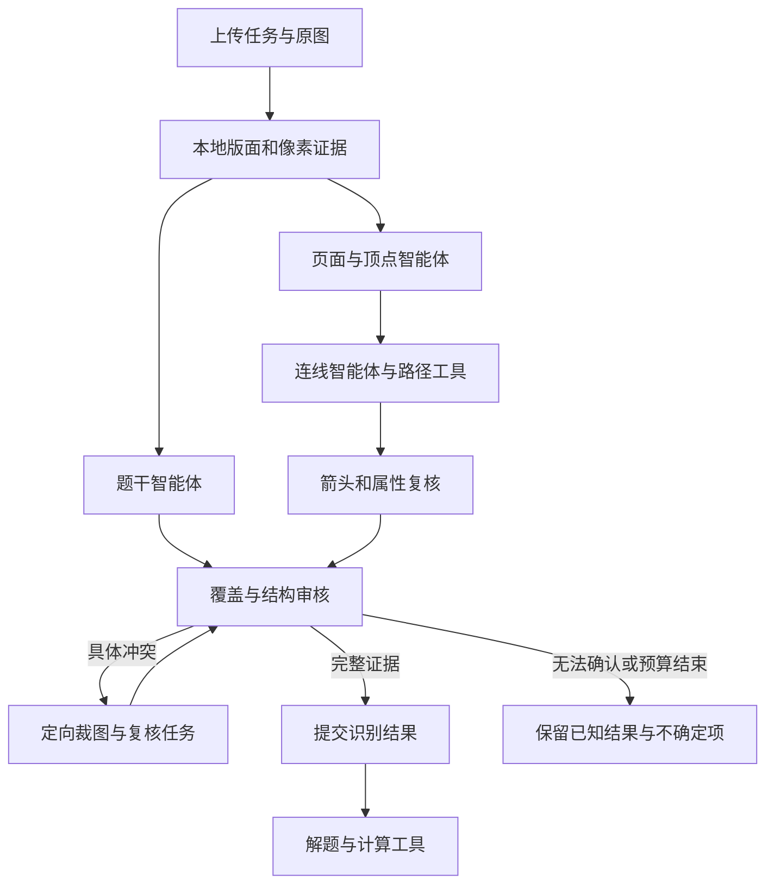

# DMate 应用内工具插件与子智能体选型及设计

## 10 月 31 日交付范围调整

用户于 10 月 26 日明确最终截止为 10 月 31 日，商业计划书、PPT 和视频也需完成。
本次交付优先推进已完成机制回归的 v3 缺陷修复、真实原图复测和稳定演示版本。
LangGraph 全面迁移、六角色编排、持久后台任务、sknw 生产接入及 SymPy 解题扩展暂不进入
本轮发布前置条件。下文保留为后续技术路线，不能写进参赛材料的“已实现能力”。

当前对外可使用的测试结论必须来自实际版本及原图回归；既有工程测试、独立库实验与尚未执行的
架构设计分别说明。材料准备与识别修复并行，不能等完整架构建成后再开始制作。

## 选型结论

根据用户“先敲定该用什么”的要求，先锁定以下技术组合，暂不推进新的架构实现或发布：

- 唯一智能体编排框架：LangGraph 的开源 Python 运行时。
- 视觉模型：沿用 Qwen3-VL-Plus，按页面/顶点、题干、连线、属性与独立审核分工。
- 文字与解题模型：沿用当前配置的 DeepSeek；像素事实由视觉证据确认。
- 第一批内部工具：现有 OpenCV、PaddleOCR、PP-DocLayoutV3、NetworkX，以及新增的 sknw 候选适配器。
- 解题工具：SymPy 与 NetworkX，使用识别后的明确结构输入。
- 调用接口：本地 Python 工具注册器；外部独立服务按需增加 MCP 适配。
- 任务与检查点存储：优先沿用现有 PostgreSQL，原图采用引用与摘要，避免在状态中重复复制图片。

不同时引入 AgentScope、Qwen-Agent、CrewAI 等第二套编排运行时；不同时加入与 sknw 职责重叠的 Skan。
选型确定不等于集成和验收完成。新增依赖的版本锁定、供应商工具协议与部署资源仍须实测。

## 目标、当前状态与设计边界

本设计针对 DMate 服务本身，覆盖图片上传、文字与图结构识别、内部复核和后续离散数学解题。
它不是为开发者的聊天环境安装插件。用户上传一次，应用内部可以调用多个工具和模型，
完成定位、提取、冲突处理与复核；供应商请求次数与用户操作次数分别记录。

当前已实现的基线是 `evidence-two-pass-v3`：固定两轮 Qwen 视觉请求、CPU 像素证据工具、
DeepSeek 等义文字校正和应用层校验。已有函数并不等于已经具有工具注册、子智能体调度、
持久任务与按冲突定向复核能力。本文的新增编排设计尚未部署，不能据此宣称原图通过。

“两次视觉请求”是基线实现及其历史验收协议，不再作为新架构的永久约束。
新版本仍须保留有限任务预算、取消与超时；预算用于控制故障和延迟，不用于强行提前宣布正确。
任何内部重新观察必须属于同一上传任务，完整记录，不能从多轮独立验收中挑最好结果。

## 一、分层与组件选择

| 层 | 选择 | 在 DMate 内的职责 | 接入状态 |
| --- | --- | --- | --- |
| 任务编排 | 选定 LangGraph 的显式状态图 | 保存阶段状态、并行独立任务、路由冲突、取消及恢复 | 选型确定，尚未接入生产 |
| 工具接口 | 本地注册器 + 参数/结果校验 + 每角色工具清单 | 统一调用图像、OCR、路径、结构和计算工具 | 待把现有函数包装为稳定接口 |
| 图像工具 | OpenCV、现有 `image_evidence` 与原图裁图 | 颜色/阴影/弱墨迹、节点轮廓、坐标映射、可回查裁图 | 核心算法已有；插件接口待封装 |
| 文字与版面 | PaddleOCR、PP-DocLayoutV3 | 文字框、转录、版面候选及执行状态 | 已接入独立本地 worker |
| 线迹提取 | 现有追踪器 + sknw 候选插件 | 原图骨架链、曲线、平行路径和环候选 | 自有追踪器已用；sknw 已选定为补充工具，尚未接入生产 |
| 结构表示/核对 | NetworkX、现有 graph schema 与 stroke checks | 独立边实例、属性与端点约束、原图支持检查 | 已有；需要作为可调用工具暴露 |
| 数学计算 | SymPy 与 NetworkX 的受限计算接口 | 逻辑公式、矩阵、关系及图算法结果验证 | 后续解题工具；不能替代图像转录 |
| 外部扩展协议 | 按需要增加 MCP 适配器 | 连接独立运行的工具服务或知识检索服务 | 可选；本地像素数组不必绕远程协议传输 |

LangGraph 官方将确定性步骤与模型步骤组合、状态保存和恢复作为编排能力；使用它不要求同时使用
整套 LangChain 模型适配。DMate 应保留已核对的供应商请求适配、原图协议与诊断字段，
通过工作流节点接入，而不是为了框架替换当前实际测试路径。[1]

Qwen-Agent 和 AgentScope 都可作为实现参考：前者提供工具/MCP 与多智能体示例，后者有
协调者分派工作者的流程。当前不同时引入数个编排框架；这样会增加状态、重试和调用记录的重叠。[2][3]

MCP 定义应用与工具服务交换上下文、发现和调用能力的协议；它本身不负责决定如何识别图片、
分派子智能体或认证识别正确性。[4]

## 二、子智能体的具体职责

协调器拥有任务状态和预算。各子智能体拥有窄任务、自己的输入快照与允许调用的工具，
返回结构化提议或冲突；只有合并器可以提交正式状态，独立审核不直接覆盖原结果。

| 角色 | 模型/执行器 | 主要输入 | 允许产出 | 可用工具 |
| --- | --- | --- | --- | --- |
| 页面与顶点智能体 | Qwen3-VL-Plus | 全页原图、版面候选、节点标记候选 | 子图/顶点清单、原标签、原图位置、范围不确定项 | 版面查询、原图裁图、marker 查询 |
| 题干智能体 | Qwen 视觉转录 + DeepSeek 受限整理 | 原题干裁图、Paddle 文字框、区域来源 | 题干/公式、文字归属、带定位的冲突 | 裁图、OCR 区域读取、文字保护校验 |
| 连线智能体 | Qwen3-VL-Plus | 已固定顶点、全图与局部图、多个工具的候选 | 独立边、路径、端点、逐顶点关联表 | 自有 trace、sknw、路径像素检查 |
| 箭头与属性智能体 | Qwen3-VL-Plus，按需执行 | 有向/加权/重边或属性争议区域 | 箭头方向、权值、边名、线型及对应证据 | 原图放大、箭头/轮廓候选、端口检查 |
| 结构审核智能体 | 程序校验 + 独立 Qwen 视觉任务 | 原图、结构草稿、覆盖和冲突清单 | 接受/拒绝/需复核的具体字段及区域 | NetworkX、schema、原图支持与重边实例检查 |
| 解题智能体 | DeepSeek | 已确认题干和结构，或明确标出的输入不确定性 | 推导、计算请求、解释 | SymPy、NetworkX、经许可的知识检索 |

同一供应商可以承载多个角色。角色独立依赖不同任务输入、工具权限、输出协议与检查职责，
不依赖给模型起不同名字。不能把六段共享同一未经验证结论的提示称为六次独立证明。

页面/顶点与题干任务在共享原图和本地证据建立后可并行；连线依赖顶点身份。
属性复核仅覆盖需要的边；最终审核必须覆盖整页面板、每个顶点、每条候选和全部题干区域。
解题阶段不能反向用“这道题应该有某种结构”修改识别记录。

## 三、一次上传的状态图



定向复核处理一个明确问题，例如“第 3 问下标是 3 还是 5”“外弧是否经过中间顶点”，
携带原图区域和待核对字段。它不是重新运行整套识别，再挑看起来最完整的一次。
修改顶点或面板会令相关候选/边证据失效，协调器须重算依赖，不能沿用旧端点的确认状态。

网络故障和内容冲突走不同分支。前者依据失败阶段和供应商请求记录执行有界恢复，保留每一次发送；
后者增加原图观察或换用有依据的工具。即使候选 JSON 语法完整，截断的流也不能当作完整响应。

初始配置建议仅允许一轮初审与至多两轮定向复核，远程请求并发从 2 起步；
单任务总时限、总调用上限与每类角色上限均配置化。以上是待实测的运行参数，
必须按原图回归与真实供应商限额调整，不能据此预报时延或准确率。

## 四、工具注册与证据接口

工具描述包含 `name`、`version`、输入和输出 schema、允许角色、CPU/内存预算、
超时、是否读取原图、是否有外部请求、结果缓存条件。版本和配置进入任务指纹。

内部统一调用可采用以下字段；这是接口设计，不是现有可调用 API：

```json
{
  "job_id": "opaque-job-id",
  "tool_name": "skeleton_trace",
  "tool_version": "pinned-build",
  "image_ref": "immutable-original-reference",
  "image_sha256": "source-hash",
  "panel_id": "G1",
  "coordinate_space": "original_1000",
  "inputs": {"mask_ref": "source-derived-mask", "vertex_revision": 2}
}
```

结果统一返回 `ok/partial/failed/cancelled`、证据引用、坐标映射、候选、诊断、
耗时及实际资源观测。骨架分叉、数学顶点、文字标签和边实例使用不同数据类型。
新增插件输出先经 schema 与范围检查，不能直接写入前端最终结构。

每个候选保存来源工具与版本、原图 SHA、输入顶点版本、真实路径和端点。
同一笔画被多个工具检出时由现有原图走廊/白缝规则去重；多个工具一致不构成额外独立像素证据。
覆盖缺失或工具触顶必须进入审核，而不是被空列表或成功退出掩盖。

子智能体只能请求注册工具。任务中共享原图引用与经过校验的证据，不共享任意可变的全局对象。
模型提出工具名和参数后，仍由 DMate 检查并执行；供应商不会替应用执行本地函数。[5]

当前 Qwen 官方模型页按地区列能力：北京支持 Function Calling，其他列出的地区并不相同。
实际工作空间端点还需独立探针。因此基础流程使用应用显式调度，不把尚未实测的原生工具调用
作为运行前提；探针通过后可以给模型开放受限的选择能力。[6]

代码审计已确认当前 Qwen SSE 接收器仅累计 content/reasoning_content，没有重建 tool_calls；
VisionProvider 也没有发送 tools/tool_choice，并只从 message.content 解析 JSON。
因此第一版由 LangGraph 显式调用本地工具。后续启用原生工具选择时必须完整支持调用 ID、
函数名、流式参数和工具结果回传，不能只向现有 payload 添加 tools 字段。

## 五、sknw 插件的确定落点

sknw 已在此前研究清单第 6 项列为候选，当前生产没有引入 `sknw/numba`。
现有实现是 OpenCV Guo–Hall 细化、自有切线追踪、Hough、曲线与轮廓候选。

接入位置是 `graph_line_tracer._graph_candidates` 已建立原图墨迹与骨架、
擦除可靠顶点标记轮廓之后。sknw 取得骨架链，附着映射层把链端口绑定到已确认数学顶点，
再与现有候选进入同一个 `keep_candidate`、`StrokeEvidence` 与视觉审核流程。

参数评估基线为 `multi=True, iso=True, ring=True, full=False`：
保留不同路径与孤立骨架点；环作为候选；路径不强制改写到骨架节点质心。[7]
这组参数并不表示原始输出可以直接当作题目的图。

必须解决以下语义差异：

- 线条交叉会形成骨架分叉，数学图未必有顶点；保持原线方向并查询真实顶点证据。
- 顶点空心圆轮廓、数字内部孔洞与真实自环要区分；纯环的人工插入骨架节点不能新增数学顶点。
- 一根空心箭头的两侧轮廓不能当两条边；箭头短分叉也不能新增顶点。
- 虚线会成为多段骨架；没有独立的片段连接证据，sknw 不能自动证明缺口属于一条边。
- 输出 `weight` 是路径几何长度，不是题目印刷权值；`pts` 坐标次序要显式转换。
- 其 NetworkX 图不自行给出箭头方向；有向语义仍由原图箭头证据确认。

PyPI 当前提供 0.15，而官方 GitHub `setup.py` 显示 0.13；实验必须绑定实际安装产物
与摘要，不能用仓库页面版本冒充安装包行为。[8]
评估保留与现有路径工具的对照，检查漏边变化、额外候选、端点附着、重边计数、冷启动和内存。
真实原图“骨架能运行”与“一次完整识别正确”分别记录。

### 选型时已完成的最小实验

已在仓库外的隔离环境实际安装并核对 sknw 0.15 的 PyPI wheel 摘要，运行 17 组配置，
全部执行完成，无模型调用、无标准答案输入。关键输出如下：

| 合成骨架输入 | 原始输出 | 对适配器的要求 |
| --- | --- | --- |
| 无数学顶点标记的 X 交叉 | 5 个骨架节点、4 条骨架边 | 交叉骨架节点不能直接升级成数学顶点 |
| 同端点三条路线 | 普通 Graph 留 1 条；MultiGraph 留 3 条 | 必须启用 multi=True 并保留边实例 key |
| 五段断开的虚线 | 10 个节点、5 条边、5 个分量 | 另需有证据的虚线片段连接工具 |
| 两个空心圆标记与一条连接线 | 2 个节点、3 条边，其中 2 条为圆轮廓自环 | 先处理真实节点轮廓，再解释自环 |
| 无分支单环 | ring=True 返回 1 个节点和 1 个自环 | 人工插入的骨架节点只作像素证据 |

这次实验依赖为 NumPy 2.5.4、Numba 0.68.0；DMate 生产约束是 NumPy 1.26.4。
因此它证明实际发布包的基本功能与语义边界，尚未证明生产依赖兼容性。
接入前须在生产版本约束下选择 Numba/llvmlite 并重新验证；不能连带升级整套生产数值依赖。
也尚未证明 sknw 加入后能改善 53 张原图的一次完整识别率。

## 六、五类图像问题与插件职责

| 问题 | 工具侧 | 子智能体侧 | 完整性依据 |
| --- | --- | --- | --- |
| 颜色 | 保留 RGB 与色差层，按原图检查浅色线 | 判断彩色线、节点与背景归属 | 每条实际颜色笔画的正确连接 |
| 透印 | 强弱墨迹分层，保留争议区域 | 结合版面与局部原图复核浅线 | 无法区分时明确不确定 |
| 模糊 | 原像素放大与质量诊断 | 对箭头、数字、端口定向复核 | 不以锐化伪影证明原字符 |
| 分图 | 版面框、裁图与统一坐标 | 逐页清点图号、分量和孤立点 | 不漏面板、不按连通性错误拆图 |
| 阴影 | 局部背景归一化、原图墨迹支持 | 检查阴影区域内节点与细线 | 排除阴影边界和桌面纹理 |

sknw 主要帮助线迹组织，不承担上述五个问题的全部解决责任。

## 七、任务持久化、资源与发布

每次上传建立稳定 job ID，原图摘要与部署版本绑定。长任务状态与结果放在服务可恢复的存储中；
不能只依赖 HTTP 连接或一个 Gunicorn worker 的内存。前端展示处理中、复核中和明确结果，
刷新页面可以查询同一任务，不再要求重新上传；提交解题依旧使用经核对的结果版本。

两核/4 GiB 下，本地重模型继续串行子进程运行；多个子智能体不各自加载 Paddle。
CPU 路径工具有独立资源界限，远程 I/O 可有限并行。sknw 的 Numba/llvmlite 引入后要测
独立进程冷启动与常驻内存，不能只报第二次调用耗时。插件故障应保留其他已完成阶段。

任务日志记录工具/模型、角色、版本、请求与响应摘要、输入证据、输出字段、失败阶段和实际调用数。
密钥只由供应商适配器读取，不进入模型上下文、工具结果、日志或交付文件。
测试密钥按用户要求保留到全部修复与交付验收完成，再清理测试副本并撤销供应商凭据。

## 八、落地与验收顺序

1. 冻结并保留已通过机制回归的 v3 基线，修复真实响应暴露的协议/定位/题干/网络诊断问题。
2. 将现有能力封装为有版本与 schema 的工具；加入只输出候选的 sknw 实验适配器。
3. 建立共享任务状态和角色输入/输出，先把固定流程迁入显式状态图，核对行为一致性。
4. 加入独立题干、边属性和结构审核任务；以具体冲突触发局部复核，保证旧证据不被无声覆盖。
5. 在测试端点真实调用 Qwen/DeepSeek；记录供应商原始终止原因、请求阶段和内部调用次数。
6. 固定一个版本完成全部原图的真实一次上传验收，逐项评估结构、属性、题干和页面；
   明确处理原图本身不可辨或物理裁切的字段。

历史基线要求恰好两次 Qwen 的评分器须增加明确版本分支；新分支核对已声明的任务图、
实际发送、审计完整性和最终证据。不能简单删除次数检查以让任何调用历史都算通过。
测试中的模型注入、像素合成图、单独 sknw 实验与真实原图验收使用不同结果字段。

## 官方依据

1. [LangGraph overview](https://docs.langchain.com/oss/python/langgraph/overview)
2. [Qwen-Agent](https://github.com/QwenLM/Qwen-Agent)
3. [AgentScope handoffs](https://doc.agentscope.io/tutorial/workflow_handoffs.html)
4. [MCP architecture](https://modelcontextprotocol.io/docs/learn/architecture)
5. [DeepSeek Tool Calls](https://api-docs.deepseek.com/guides/tool_calls/)
6. [Qwen3-VL-Plus 模型能力](https://help.aliyun.com/zh/model-studio/qwen3-vl-plus)
7. [sknw README 与实现](https://github.com/Image-Py/sknw)
8. [sknw PyPI](https://pypi.org/project/sknw/)
9. [NetworkX MultiDiGraph](https://networkx.org/documentation/stable/reference/classes/multidigraph.html)
10. [SymPy logic](https://docs.sympy.org/latest/modules/logic.html)
11. [LangGraph persistence](https://docs.langchain.com/oss/python/langgraph/persistence)
