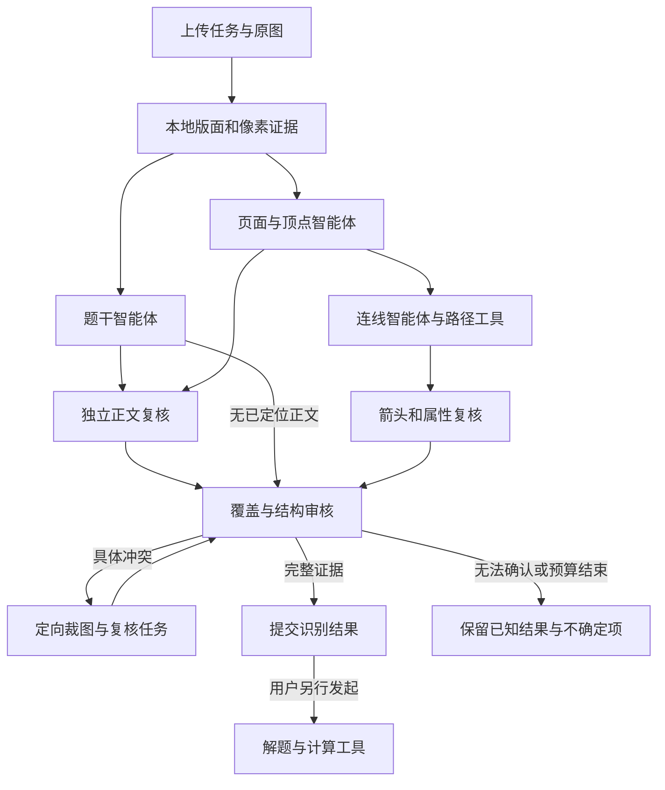

# DMate 应用内工具插件与子智能体实现状态及架构设计

## 10 月 26 日最新实施决定

用户最新明确：按统一渲染后的题意与图结构验收，删除精确坐标等无关的内部硬标准，加快交付。
因此停止把未发布的严格 `agent-tools-v6` 作为默认改进方向，新增精简语义链
`2026-10-26-agent-semantic-v1`。现有 `agent-tools` 配置直接进入此链，不新增必需环境变量。
LangGraph、应用内工具注册器与独立视觉角色保留；默认链不再运行 marker/sknw 像素候选验收，
不要求模型输出坐标、路径、证据框、逐节点读取记录或多套 OCR ID 的覆盖清单。
本节描述发布前已经实现的代码，后续仍须工程验证、部署和原图实测；不能当作新版准确率结论。
当前已知线上版本仍为 v5，其六张原图首响应均未完成内容验收。私有总回归范围为 86 张，
未在新版上传的原图不计新版通过。

测试结论必须绑定实际版本及原图回归；工程测试、独立库实验和真实供应商调用分别说明。

## 精简语义链及研究取舍

1. `image.semantic_views` 提供完整彩色总览，大照片另加四个重叠原像素局部，小图必要时加光照归一化辅助。
   最多五图，明确它们属于同一原图；本地 OCR 只作有限长、可能有错的提示。
2. Qwen 读取题干与子图，先找真实节点，再从每个节点沿线确认终点，返回精简节点/边表。
   自环、平行边、反向弧、孤立点、印刷边名、权值、颜色与线型均保留。
3. 新模型上下文重新读取原图，视觉复核草稿并返回完整修正版。默认 Qwen；多子图、密集或模糊页，
   如现有 `ZHIPU_API_KEY` 可用，可选 `glm-5v-turbo` 复核。缺服务或调用失败时继续 Qwen。
4. 只有具体语义问题或未完成复核时，在同一次上传内追加一轮定向修复。机械坏包不能抹掉有效首稿；
   正文和各子图的不确定项分别保留。未完成独立复核不标完整。
5. 语义 adapter 输出同一份 canonical 图供 UI 与解题文本使用；坐标/路径可以缺省，颜色与线型实际显示。
   DeepSeek 仍只做受约束文字整理，服务失败保留视觉原文，不再变成图内容验收门。

保留有效端点引用、真实顶点和边实例、方向、关键文字与子图归属检查。内部 ID 可稳定生成；
冗余图类型开关从逐边事实整理，混合方向与部分有权图不因总开关矛盾被拒。
超时、取消、源文件身份和 HTML 转义继续作为运行保护，不作为图片内容正确的证明。

- [Ariadne](https://arxiv.org/abs/2610.04721) 确实采用节点清单与源节点条件化边提取。
  当前借鉴“先核节点，再逐源节点检查连接”的读取顺序和定向复核；没有训练其任务适配模型，
  不声称复现论文准确率，也不强制每张简单图新增一轮节点 API 调用。
- [MeshAgent](https://zaoxing.github.io/papers/2026/SIGMETRICS26_MeshAgent.pdf) 实际研究网络管理约束。
  借鉴其一致性检查方法，但自环、重边、孤立点可以合法，不凭欧拉性质或常见图形补点补边。
- [TopoEdge](https://arxiv.org/abs/2603.00569) 的相关论文研究 SDN 配置生成与执行验证。
  借鉴独立验证、具体失败反馈和局部修复，不把网络配置测试器当图像识别器。
  私有错题集按原图与人工语义标注回归，不进入运行时提示、路由或答案查表。
- [GLM-5V-Turbo 官方文档](https://docs.bigmodel.cn/cn/guide/models/vlm/glm-5v-turbo) 已核实图片/多图/SSE/思考开关。
  adapter 已加入显式模型支持，实际 provider/model 分别记账；本地开发环境无此密钥，未冒充真实 GLM 实测。

新版离线验收比较题干、独立子图、节点标签与带属性的多重边；无标签节点允许内部 ID 不同的图同构。
仅排版不同的已知节点编号可明确归一，大小写、不同数字、上下指数不能混同。
原图裁切等不可恢复内容单独标无法认证，不能靠补猜宣称完整通过。以下版本记录均为历史实测。

## 版本、真实实测与当前实施状态

当前线上 `agent-tools-v5` 使用 LangGraph 调度独立题干读取与“页面/顶点→连线”两条执行分支，并新增独立正文复核；所有有边图再经属性审核和独立整页审核，具体冲突默认最多触发两轮定向返工。一个上传任务共享调用预算、取消标记、请求时限、revision 和角色/工具审计。生产默认随现有 `DMATE_GRAPH_NEXTGEN=1` 进入此链路；不要求用户再设置开关。`DMATE_GRAPH_PIPELINE=evidence-two-pass` 可显式选择保留的 `evidence-two-pass-v3` 比较基线。

### v5 已部署：六张首次响应全部未通过

[PR #13](https://github.com/zm14744/DMate/pull/13) 已合入 main `29fe25b2da721c95151daa9ad71dafe082c842ed`，
源码 tree 为 `e380827e4b6fd46f85f1fff8f9841391b2f4145b`。
[CI 40316193872](https://github.com/zm14744/DMate/actions/runs/40316193872) 的机制和资源门成功；
本地 1536 个单元测试与 4 个不同的真实 Chromium 用例通过。Zeabur 精确提交检查 `121554555350`
于 11:48:09 UTC 成功，11:49:23 与 11:49:32 两次健康检查均确认 v5。健康接口不发布 Git SHA。

六次浏览器上传各使用原文件一次，均收到同一 v5 的 HTTP 200 / partial；不是六次通过。
原文件身份与首响应绑定全部通过，冻结 v5 评估器的内容验收全部失败，另外 80 张未在 v5 执行。
服务端记录 Qwen 共 41 次发送，26 次完成返回、15 次失败；其中部分失败已收到 HTTP 200 但 SSE 未完成，
不能把这些响应头状态当作成功输出。非空题干样本有 DeepSeek 成功返回；空题干不发空整理请求。
这些记录不是独立供应商账证，不能据此宣称执行认证。

| v5 原图 | 实际改善或已读取部分 | 仍然阻断的事实 |
| --- | --- | --- |
| `supplement_07` | 5 点和 7 条原像素支持的连线正确，外弧端点正确 | 7 个印刷边名均漏读；第③问仍把 v₅ 读成 v₃；独立正文复核混淆覆盖 ID；终审仅余 23.195 秒预算并在 SSE 输出中截止 |
| `slides_01` | 节点标签与拒稿中的 9 条端点/权值可读 | 5 个节点位置仍不可信，最终 0 边；定位疑点等待不可达的终审，两轮返工只重做连线；正文初稿角色矛盾后重读 |
| `supplement_04` | 空正文正确 | 原图 10 点，被盘点为 11 点；5 个位置未确认，最终 0 边；未进入页面定位返工 |
| `test2_021` | 自环、两条同向重边和孤立点被保留 | 两个箭头尖端被当节点，实际下排节点漏读/错标，最终 6 点 7 边而拓扑错误；两处文字角色矛盾，属性和终审未运行 |
| `test2_012` | 五个面板框大致可读，正文主问出现在拒稿中 | 每图机械式 8 点，共 40 点而原图 35 点；11 点越出所属面板范围；0/49 边提交；两次 75 秒连线输出截止；图注排除证据框过宽而被拒 |
| `photos_02` | 本地背景归一化实际执行 | 4 个可见子图被合成 1 图 23 点，最终 0/27 边；正文长输出截止、页面重复绑定同一 marker。顶部题干在原照片中已被裁掉，不能补猜 |

新加入 33 图中的自环/重边与五面板样本已实际执行，没有只测旧三图。
原先的颜色、透印、模糊、分图、阴影五类问题仍在总验收范围；以上局部改善不能代表它们已全部解决。

### v6 未发布原型：已被上述语义方案取代

以下保留开发历史，并非当前默认识别要求。用户明确取消无关几何硬门后，不再部署该严格方案。

- 图分支在页面完成后依次执行连线和属性，与题干及其独立复核同时推进；终审等待两路汇合。
  保留统一预算、取消和最多两个远程并发，正文结果不能覆盖较新的图状态，属性不能无故重复运行。
- 具体连接几何拒绝同时伴随当前未确认节点位置时，协调器最多额外安排一次原图定位复核。
  单纯网络失败不触发节点重读，CV 未检出仍不等于节点不存在，不自动移动节点或把候选数量当答案。
- 页面可读原图、背景归一化辅助图以及 CPU 候选的原像素邻域拼图；候选仍可为箭头、字形或噪声。
  拼图不绘字或答案，至多 64 块、2MP、最大边 1600，每块最多放大 6 倍；坐标和遗漏显式记录。
  模型仍须根据完整原页选择实际顶点，运行时不把候选直接变成顶点。
- 页面解码检查节点中心在自身声明面板范围内；越界保留具体图、点、坐标和范围，要求重新定位或修框，
  不把跨图节点静默搬运。不同子图号和独立面板与同图非连通分量分别处理。
- 正文复核与终审收到本次真实区域/OCR ID 的精确名单，移除可被照抄的虚构示例身份。
  两处文字区域的角色含义一致；图内标签的 `graph_id=null` 不代表它属于正文。
- 追加正文裁图优先已经定位的 OCR 疑点，再补其它区域。本次 s07 三张实际追加图经 PNG 摘要复现确认
  只覆盖题头、①、②，③、④受容量限制；不能把同样错字的全部原因归于这项遗漏。
- 属性读者获得固定边的原路径与未分配给某条边的图内文字提示；已有 null 只表示草稿未识别，
  内部边 ID 不冒充印刷边名。所有实际改变继续要求原位置证据并重新检查像素。
- 每次模型 attempt 保存自己的失败事实；明确的本地输出 `wall_deadline` 不再被误当成可原样恢复的网络故障。
  仍保留响应头/连接阶段暂态错误的有界恢复，不接收截断 JSON，不延长总请求截止时间。

这些修复尚须冻结源码、完整工程门、部署和新的原图首响应验收。按子图隔离长响应任务、绑定各自输入身份
并原子汇总，仍需要单独设计和验证；仅修提示、增加候选拼图或取消一次盲重试不能宣称多图问题已解决。

### v4 已部署：三张顽固原图均未完成验收

[PR #12](https://github.com/zm14744/DMate/pull/12) 合入 main `a7bdda09d4822048681ec923da15128a443d951f`，
源码 tree 为 `98907781bd968bfe7d15450a25de2507d5a0fcdb`。
[CI 40307577773](https://github.com/zm14744/DMate/actions/runs/40307577773) 的机制与资源门成功，
Zeabur 检查 `121525526551` 于 10:39:27 UTC 成功，10:40:46 与 10:40:54 两次健康检查均为 v4。
本地冻结验证为 1369 个不同工程用例，含 4 个实际 Chromium 用例；不是原图准确率。

| v4 原图 | 实际读取与改善 | 仍然阻断的事实 |
| --- | --- | --- |
| `supplement_07` | 5 点正确；最后拒稿的 7 对端点正确，外弧显式采用受支持候选；初次连线比正文返回早 51.921 秒，局部裁片实际发送 | `incomplete_source_read` 拒绝整稿，最终 0 边；轮廓拟合回退分数被模型误当顶点不存在的依据；正文仍有关键下标误读，属性和独立终审未运行 |
| `slides_01` | 7 点及 9 条边的端点、方向、权值均与原图相符；9 条空心箭头均绑定受支持的原像素连接轮廓 | 页面修订后，旧坐标诊断从旧拒稿被再次带回成功连线包；唯一残余页面问题挡住属性与终审，仍为 partial |
| `supplement_04` | 本地 marker 工具确实给出全部 10 个真实圆心，零 API 回放摘要与线上工具结果完全相同；空正文正确 | 最终页面提案有 12 点，含 5 个未观察到标记的位置，并漏 3 个真实圆；三次连线在像素验证前因错误候选复用被拒，最终 0 边 |

三次上传的 Qwen 共记录 20 次实际发送，其中 18 次 HTTP 200、2 次响应头阶段传输失败；
非空正文样本有 DeepSeek 成功响应，空正文两图没有发起空整理请求。
这些是服务端调用与浏览器首响应证据，独立供应商传输账证仍未提供，不能标成执行认证。
原图、首响应、人工核对及冻结 v4 评估器报告私下保存，不进入运行时或本仓库。

### v5 已部署的修复范围：按 v4 实证完善证据作用域与独立复核

- 连线模型只收到用于端点遮罩、轮廓和端口定位的几何提示；移除容易被当成顶点存在概率的裸 `footprint_confidence`，真实 CV 分数仍保留在内部测量与诊断中。读不全仍拒绝，不提高分数、不放宽像素门。
- 机器 `connection_source_coverage` 失败绑定本次固定图、已知顶点 ID 和原坐标。第一次连接返工即可根据同一身份裁原图，未知 ID 不会变成裁图坐标。
- 拒绝提案绑定其固定图和候选输入摘要。页面或候选作用域变化时旧反馈失效并留审计，不再把旧坐标带入新提案；同作用域的有效反馈继续使用。
- 页面可明确用 `marker_id` 引用其已在原图确认的本次标记候选，仅当两个坐标都缺省时派生该候选原坐标；未知/重复绑定、单坐标缺省、显式空值或冲突坐标均拒绝。候选仍不自动成为数学顶点，模型可按原图定位未被工具检出的标记。
- 页面返工获得当前未绑定强 marker 与未观测位置的结构化上下文，并按固定 marker/顶点 ID 放大原像素；不把模型任意证据框当裁图指令，不提高吸附距离，不按图形模板补点。
- 新增可选 `body_review` 视觉角色：已有正文和页面范围后即可与连线并行，图尚无有效边也能逐行复核正文。它逐 ID 覆盖原正文区域及 OCR hints，改字/删除必须有同位置原像素证据，不能修改图或替代全页终审。
- 正文复核绑定文字、原区域、hints 和页面范围摘要。同一摘要只尝试一次，图边或属性修订不触发重复全文读取；A→B→A 恢复先前同作用域结果并留事件。辅助复核失败保持可见，最终独立全页审核仍可重新看原图处理正文。
- 全页审核已通过正文协议、但图仍需返工时，保存其较新的同位置正文子结果；后续连线失败不会退回初读或较早正文复核的文字。未经完整正文解码的终审原稿不能进入此缓存。
- 裁图工具支持调用方已验证的正文区域和 CPU marker 两个独立 ID 空间，沿用每次最多 3 张、单张 1MP、总量 2MP、最大放大 6 倍及全原图坐标映射。`body_review` 仅有只读裁图权限。
- 已知页面协议错误保留具体代码和字段，例如字符串布尔值不会被当成 JSON 布尔值，也不会只反馈无定位的 `ValueError`。

上述改动已绑定冻结源码、CI、部署版本并完成六次真实首次响应验证；结果见上表，没有 v5 原图通过结论。

### v3 已部署，真实图片仍未通过

[PR #11](https://github.com/zm14744/DMate/pull/11) 已合入 main `9770176`，
[CI 40300594163](https://github.com/zm14744/DMate/actions/runs/40300594163) 的机制与资源门均成功。
Zeabur 检查 `121502545089` 于 2026-10-26 09:46:54 UTC 成功；09:48:11 和 09:48:19 UTC
两次健康检查返回 `2026-10-26-agent-tools-v3`。健康接口未返回 Git SHA。
该版本本地冻结源码通过 1228 个不同工程用例，含 4 个真实 Chromium 用例；这不是原图准确率。

| v3 原图 | 真实首次响应与供应商调用 | 实际内容结论 |
| --- | --- | --- |
| `supplement_07` | HTTP 200、partial；7 次 Qwen 均返回 200；DeepSeek 实际调用成功 | 节点与大部分连接恢复；仍有正文关键字符误读、外弧端点错误及漏报印刷边名；独立终审未执行 |
| `slides_01` | HTTP 200、partial；6 次 Qwen 均返回 200；空正文无需 DeepSeek 调用 | 节点及边端点、方向恢复；权值只进入边名字段；空心箭头未保留实测候选绑定，9 条路径全部 pending；独立终审未执行 |
| `supplement_04` | HTTP 200、partial；6 次 Qwen 均返回 200；空正文无需 DeepSeek 调用 | 10 个无字节点定位正确、正文正确为空；三次连线均被候选覆盖协议拒绝，最终 0 条提交边；最后拒稿仍有颜色误读，属性与终审未执行 |

供应商成功返回不能替代内容验收。私有原图、逐字段判断与首响应保存在
`online_agent_v3_20261026_01`，不进入仓库。其他原图须按同一版本单独记录，不从不同上传中拼接成功结果。

### v4 已部署的修复范围

- 初始工作流使用两个独立执行分支：题干读取与“页面清单 → 连线”。页面完成即可开始连线，不再等待 LangGraph 初始并行步中的长题干请求；合并时题干不能覆盖较新的图清单或 revision，仍按当前清单验证归属。
- 本地像素冲突保持原有身份、责任角色和测量证据。同 ID 的模型解释只保留为观察，不再覆盖机械反证；指向另一上游角色的额外问题单独留存。
- 协议有效的软文字疑问交给独立原图复核，不再随每次连接返工重复整稿读取；有效 hint ID 和原始位置一并传递，已经解决的旧拒稿细节不污染新问题。此路由不提升完整性，也不自动改字符。
- `image.focused_views` 按已有 hint、边、顶点身份截取原始像素，每次最多 3 张、总量最多 2 百万像素；明确给出完整原图坐标映射。每个视觉角色最多接收总览、复核图及 3 张裁片，实际发送和图像摘要使用同一组图片；历史非 agent 调用仍默认最多 2 张。
- 连线提示先对照原图核实候选，再显式复用同笔画、同端点且受原像素支持的完整路径。只有合法候选的两个端点字段同时缺省才可派生；显式错误值不修补。极窄的缺失引用归一化只接受互为唯一的整路径舍入等价，并记录本地审计，仍须再次像素验证。
- 所有含边的图都进入属性读取，避免上游漏填边名或权值又触发“无需属性审核”的循环。属性改变仍绑定当前边 ID 并复查原像素，终审仍为必要条件。

以上是当前修复范围，不是图片通过声明。总请求、实际并发、原图坐标、取消与整任务截止限制继续有效。

### v2 已部署，真实图片仍未通过

[PR #10](https://github.com/zm14744/DMate/pull/10) 已合入 main `18943d4`，
[CI 40295397179](https://github.com/zm14744/DMate/actions/runs/40295397179) 成功；
Zeabur 检查 `121485059331` 于 2026-10-26 09:05:30 UTC 成功。
09:06:39 和 09:06:48 UTC 的两次 `/health` 均返回 `2026-10-26-agent-tools-v2`。
健康版本与部署检查共同记录上线状态；健康接口本身不返回 Git SHA。

该发布的工程验证为 **1163 个不同测试通过，其中包含 4 个真实浏览器用例**。
这些测试验证机制与应用流程，不是 1163 张原图识别，也不代表下表图片通过。

| v2 原图 | 真实首次响应 | 已确认结果与阻断 |
| --- | --- | --- |
| `supplement_07` | HTTP 200，`recognition_status=partial` | 5 个节点定位正确；7 条边草稿中 6 条 accepted、1 条 pending；正文协议失败，未进入 DeepSeek 校正 |
| `slides_01` | HTTP 200，`recognition_status=partial` | 7 个节点标签存在，其中 5 个节点坐标错误；没有提交的边、正文为空；DeepSeek 为 `empty` 跳过，无需发起空正文校正 |

以上两次均为真实浏览器上传、真实 `/ocr` 和已配置 Qwen 服务；随后 `supplement_04` 也返回 `partial`，
存在顶点定位和候选绑定阻断，未提交边。不能把 HTTP 200、局部正确或候选生成称为完整识别成功。
私有首响应与观察保存在 `online_agent_v2_20261026_01`；本仓库只记录状态、数量与故障机制，不包含原图、金标或私有响应内容。

### v1 历史上线与实测

v1 首次上线的预期 main 为 `9d29b6971a268f8749af9045a5b32d8851143ebc`。
2026-10-26 08:09:02 UTC 保存的 `/health` 返回 HTTP 200、`engine=agent-tools`、
`version=2026-10-26-agent-tools-v1`、`enabled=true`；后续真实 `/ocr` 首响应也带同一版本。
这确认线上已经启用 v1 链路。健康接口没有返回 Git SHA，不能单凭该接口证明部署提交字节完全一致。
此后 [PR #9](https://github.com/zm14744/DMate/pull/9) 的 CI 全部通过并合入 main `9cbfcee`；
CI 和 main 更新是工程交付记录，不替代线上原图效果验收。v2 的后续部署与实测见上节，不能与 v1 混用。

两张原图均经过真实浏览器上传、真实 `/ocr` 和已配置的 Qwen 服务，未 mock 接口、未用标准答案生成响应，结果均失败：

| v1 原图 | 首次 `/ocr` 响应 | 服务记录的 Qwen 发送 | 实际结果与已知阻断 |
| --- | --- | --- | --- |
| `supplement_07` | HTTP 200，`recognition_status=partial` | 6 次：4 次 HTTP 200、2 次传输失败；页面 1、题干 1、连线 4 | 返回 1 图、5 点、0 边、空正文；记录 `body_fragment_not_in_text`、`changed_candidate_endpoints`、`unknown_or_duplicate_retired_edge`，并有节点标记位置偏差 |
| `slides_01` | HTTP 200，`recognition_status=partial` | 5 次，均记录 HTTP 200；页面 1、题干 1、连线 3 | 返回 1 图、7 点、0 边、空正文；连线三次被 `changed_candidate_endpoints` 拒绝，未完成独立全页验收 |

发送次数来自保存的 `agent_workflow` 与逐请求 `remote_metrics`，包含实际远程响应和失败记录；
不是独立供应商账单或另一路传输观察器的认证。HTTP 200 表示请求返回，不等于题干或结构正确。
v1 没有保存被协议拒绝的完整原始提案，因此不能反推某个未保留字段的具体内容。
私有证据位于 `online_agent_v1_20261026_01` 的部署观察及两图首次请求、首次响应、UI 观察，原图和私有响应不进入本仓库。

### v2 已部署的修复范围

以下改动已随 v2 部署，仍受到上述真实失败结果的约束，不能据此宣称图片准确率：

- 正文以按阅读顺序排列的 `regions[role=body].text` 为唯一来源，安全推导重复字段；格式等价只用于比较，字词、下标、数值变化仍须原位证据和独立终审。
- 拒绝反馈携带具体 hint/edge/candidate ID、短 expected/actual 字段和未提交提案，供对应角色定向修正；未提交提案与 `previous_graphs` 中可退役的已提交边严格分开。
- 候选线迹是可错提议，模型可独立给路径并省略候选绑定；显式绑定仍要求同一候选和端点，不能靠放松校验消除冲突。
- 返工在未解决角色之间按已获返工次数选择，避免同一连线错误占用全部机会而独立题干错误一直未重读；总预算和轮数限制仍生效。
- 页面角色提前获得有像素来源的 marker 提示，明确标签大小写/上下标与标记中心；后续唯一匹配保持节点身份，未绑定标记和远离标记节点进入诊断，不能把提示数量当最终节点数。
- 本地未检出的标记、图像边界处的裁切和有多个候选的位置，不直接等同于节点错误。非硬冲突继续进入连线和独立视觉审核；终审须对指定节点逐项给出匹配当前 revision 坐标的局部原图证据。确认不会伪造 CV 定位结果；未确认则定向交回页面角色。
- 工具或传输失败只记录本阶段失败，不借用上一轮已提交响应充当被拒草稿。正文协议失败也不能被“空正文”的终审表态掩盖；未提交正文只作错误反馈，不成为下一轮的已确认修改历史。
- 属性角色确认的边颜色在再次像素校验后保留，并继续传给独立审核；原图具有彩色墨迹时触发属性复核。终审明确要求重读属性时不能被首轮的条件跳过，颜色也不能用来自动增边或合并边。

### v3 已部署的修复范围

`agent-tools-v3` 针对 v2 首响应暴露的故障修复，不与历史 `evidence-two-pass-v3` 混淆。已部署范围如下：

- 追踪插件只把白名单内有限的 NumPy 浮点测量转换为原生 JSON 数值，防止一个诊断字段使整批候选被拒；全局 JSON 类型、非有限值与容量限制保持不变。
- 模型可显式引用同图、同端点且已有原图像素支持的候选，并省略 `path` 以复用其完整采样路径；复用后仍重新校验。采样点不是新增数学顶点，未通过像素门的候选不能借此进入结果。
- 正文区域在角色及原图坐标契约成立时可省略 `source`，由本地明确补为 `original`；显式错误来源仍拒绝。证据矩形允许规范两个对角点的顺序并留审计，越界或零面积仍拒绝。
- 提前检查首轮正文协议，将可独立处理的正文与图结构返工并行安排，继续共享任务预算、角色审计与取消状态。
- 已知硬失败未解除时先处理具体冲突，避免耗尽预算后才进行无法接收的独立终审；不能通过跳过终审宣布识别完成。
- 被拒提案中经独立校验的上游诊断已接入：连线提案的边表即使未获提交，其有原图依据的节点问题仍回到页面角色；失败结构本身不能混入已提交状态。
- 公平返工只选择当前依赖已满足的角色，避免属性阶段因连线未修而空耗一轮；旧正文因新版图清单失效时，拒稿记录仍保留较新 revision 的具体错误。

上述改动已随 v3 发布；v4 的后续改动、真实失败和 v5 修复见上节。

本地工具注册器已封装原图标记、版面/OCR提示、原图裁图、自有路径追踪、sknw候选、像素准入和NetworkX结构审核。数学计算插件（NetworkX邻接矩阵/通路计数/欧拉性质、SymPy受限逻辑/矩阵）只接受已确认的结构输入；OCR不会自动启动解题。供应商原生Function Calling、持久后台任务、刷新恢复和界面中的数学工具选择仍未启用，不能把已安装LangGraph描述为已经完成持久任务平台。

sknw 已在独立 Python 3.10.22、NumPy 1.26.4、Numba 0.61.2 和 llvmlite 0.44.0 下实际验证并接入候选工具。子进程使用Paddle共享锁、1 CPU、内存和硬截止限制，输出始终是候选。生产依赖单独锁定于 `requirements-agents.txt`，Docker构建与CI同时安装。

历史 `evidence-two-pass-v3` 基线也保留了 2026-10-26 的 `supplement_07` 失败记录：第一轮 Qwen 返回 200，
第二轮 8.374 秒在响应头之前出现 TimeoutError 链；日志不足以把上传写超时确认为唯一根因。
该历史结果与 v1–v5 实测及当前 `agent-tools-v6` 本地修复分别归档，不跨版本拼成一次成功验收。

## 选型结论

根据用户已确认的选型与最新实施要求，使用以下技术组合：

- 唯一智能体编排框架：LangGraph 的开源 Python 运行时。
- 视觉模型：沿用 Qwen3-VL-Plus，按页面/顶点、题干、连线、属性与独立审核分工。
- 文字与解题模型：沿用当前配置的 DeepSeek；像素事实由视觉证据确认。
- 第一批内部工具：现有 OpenCV、PaddleOCR、PP-DocLayoutV3、NetworkX，以及新增的 sknw 候选适配器。
- 解题工具：SymPy 与 NetworkX，使用识别后的明确结构输入。
- 调用接口：本地 Python 工具注册器；外部独立服务按需增加 MCP 适配。
- 任务与检查点存储：持久化仍为后续设计，优先复用现有 PostgreSQL；当前上传流程未实现跨进程持久任务与刷新恢复。

不同时引入 AgentScope、Qwen-Agent、CrewAI 等第二套编排运行时；不同时加入与 sknw 职责重叠的 Skan。
上述本地编排和候选工具已集成，生产依赖已锁定并通过工程 CI；实际识别效果仍须逐版本实测。
供应商原生工具调用协议与持久任务平台尚未接入，不能以框架支持这些能力代替应用实现。

## 目标、当前状态与设计边界

本设计针对 DMate 服务本身，覆盖图片上传、文字与图结构识别、内部复核和后续离散数学解题。
它不是为开发者的聊天环境安装插件。用户上传一次，应用内部可以调用多个工具和模型，
完成定位、提取、冲突处理与复核；供应商请求次数与用户操作次数分别记录。

当前线上已确认的流程是 `agent-tools-v5`，已经具有本地工具注册、显式角色调度和按冲突定向返工。
`evidence-two-pass-v3` 是固定两轮 Qwen 的历史比较基线。`agent-tools-v6` 的分支调度、定位和输入协议修复仍在本地验证，
持久后台任务、跨刷新恢复、供应商原生 Function Calling 和数学工具 UI 仍未实现。
本文后续相关章节属于未来设计；已部署编排本身和工程 CI 均不能证明原图识别正确。

“两次视觉请求”是基线实现及其历史验收协议，不再作为新架构的永久约束。
新版本仍须保留有限任务预算、取消与超时；预算用于控制故障和延迟，不用于强行提前宣布正确。
任何内部重新观察必须属于同一上传任务，完整记录，不能从多轮独立验收中挑最好结果。

## 一、分层与组件选择

| 层 | 选择 | 在 DMate 内的职责 | 接入状态 |
| --- | --- | --- | --- |
| 任务编排 | LangGraph 显式状态图 | 保存请求内状态、并行独立任务、路由冲突及取消 | v5 独立正文复核已部署；v6 图属性并行在本地验证；持久恢复未实现 |
| 工具接口 | 本地注册器 + 参数/结果校验 + 每角色工具清单 | 统一调用图像、OCR、路径、结构和计算工具 | v1 已接入；由应用显式调度，供应商原生工具选择未实现 |
| 图像工具 | OpenCV、`image_evidence` 与原图裁图 | 颜色/阴影/弱墨迹、节点轮廓、坐标映射、可回查裁图 | v2 页面 marker 提示与定位诊断已部署，实图仍暴露节点错位 |
| 文字与版面 | PaddleOCR、PP-DocLayoutV3 | 文字框、转录、版面候选及执行状态 | 已接入独立本地 worker |
| 线迹提取 | 自有追踪器 + sknw 候选插件 | 原图骨架链、曲线、平行路径和环候选 | v1 已接入；sknw 固定依赖已在生产 Python/NumPy 约束下验证，候选不等于最终边 |
| 结构表示/核对 | NetworkX、graph schema 与 stroke checks | 独立边实例、属性与端点约束、原图支持检查 | v1 已作为本地工具接入，仍须视觉审核与完整性校验 |
| 数学计算 | SymPy 与 NetworkX 受限接口 | 逻辑公式、矩阵及图算法结果验证 | 计算工具已实现；OCR 不自动求解，数学工具 UI 和完整解题交互未实现 |
| 外部扩展协议 | 按需要增加 MCP 适配器 | 连接独立运行的工具服务或知识检索服务 | 可选；本地像素数组不必绕远程协议传输 |

LangGraph 官方将确定性步骤与模型步骤组合、状态保存和恢复作为编排能力；使用它不要求同时使用
整套 LangChain 模型适配。DMate 应保留已核对的供应商请求适配、原图协议与诊断字段，
通过工作流节点接入，而不是为了框架替换当前实际测试路径。[1]

Qwen-Agent 和 AgentScope 都可作为实现参考：前者提供工具/MCP 与多智能体示例，后者有
协调者分派工作者的流程。当前不同时引入数个编排框架；这样会增加状态、重试和调用记录的重叠。[2][3]

MCP 定义应用与工具服务交换上下文、发现和调用能力的协议；它本身不负责决定如何识别图片、
分派子智能体或认证识别正确性。[4]

## 二、子智能体的具体职责

协调器拥有任务状态和预算。各子智能体拥有窄任务、自己的输入快照与允许调用的工具，
返回结构化提议或冲突；只有合并器可以提交正式状态，独立审核不直接覆盖原结果。

| 角色 | 模型/执行器 | 主要输入 | 允许产出 | 可用工具 |
| --- | --- | --- | --- | --- |
| 页面与顶点智能体 | Qwen3-VL-Plus | 全页原图、版面候选、节点标记候选 | 子图/顶点清单、原标签、原图位置、范围不确定项 | 版面查询、原图裁图、marker 查询 |
| 题干智能体 | Qwen 原图转录；DeepSeek 仅作后续受限整理 | 原题干裁图、Paddle 文字框、区域来源 | 题干/公式、文字归属、带定位的冲突；v2 由有序原图区域形成单一正文 | 裁图、OCR 区域读取、文字保护校验 |
| 独立正文复核 | Qwen3-VL-Plus 的新独立视觉任务，v5 已部署 | 原图、已定位正文和 OCR hints；仅用页面范围判断文字归属 | 同位置证据约束的正文修订及明确疑点；不输出图验收 | 原始像素复核图和定向裁图，只读 |
| 连线智能体 | Qwen3-VL-Plus | 已固定顶点、全图与局部图、多个工具的候选 | 独立边、路径、端点、逐顶点关联表 | 自有 trace、sknw、路径像素检查 |
| 箭头与属性智能体 | Qwen3-VL-Plus，所有有边图执行 | 当前固定边实例及原图 | 箭头方向、权值、边名、线型及对应证据 | 原图放大、箭头/轮廓候选、端口检查 |
| 结构审核智能体 | 程序校验 + 独立 Qwen 视觉任务 | 原图、结构草稿、覆盖和冲突清单 | 接受/拒绝/需复核的具体字段及区域 | NetworkX、schema、原图支持与重边实例检查 |
| 解题智能体 | DeepSeek | 已确认题干和结构，或明确标出的输入不确定性 | 推导、计算请求、解释 | SymPy、NetworkX、经许可的知识检索 |

同一供应商可以承载多个角色。角色独立依赖不同任务输入、工具权限、输出协议与检查职责，
不依赖给模型起不同名字。不能把六段共享同一未经验证结论的提示称为六次独立证明。

页面/顶点与题干任务在共享原图和本地证据建立后可并行；连线依赖顶点身份。
属性阶段对所有有边图按固定清单逐边复核；v5 另在不依赖有效边的分支独立复核已定位正文。
最终审核必须覆盖整页面板、每个顶点、每条边和全部题干区域。
解题阶段不能反向用“这道题应该有某种结构”修改识别记录。

v2 的角色修复仍是本角色重新提出完整结果，不是协调器替模型补答案。失败草稿的角色、revision、
原图来源与具体拒绝字段必须保持绑定；返工成功前不能把失败草稿算作已提交结构。
正文和连线可分别失败，公平返工保证独立问题有机会得到重读；任何角色自报 complete 都不能覆盖程序校验或终审失败。

## 三、一次上传的状态图



定向复核处理一个明确问题，例如“第 3 问下标是 3 还是 5”“外弧是否经过中间顶点”，
携带原图区域和待核对字段。它不是重新运行整套识别，再挑看起来最完整的一次。
修改顶点或面板会令相关候选/边证据失效，协调器须重算依赖，不能沿用旧端点的确认状态。

网络故障和内容冲突走不同分支。前者依据失败阶段和供应商请求记录执行有界恢复，保留每一次发送；
后者增加原图观察或换用有依据的工具。即使候选 JSON 语法完整，截断的流也不能当作完整响应。

初始配置建议仅允许一轮初审与至多两轮定向复核，远程请求并发从 2 起步；
单任务总时限、总调用上限与每类角色上限均配置化。以上是待实测的运行参数，
必须按原图回归与真实供应商限额调整，不能据此预报时延或准确率。

## 四、工具注册与证据接口

工具描述包含 `name`、`version`、输入和输出 schema、允许角色、CPU/内存预算、
超时、是否读取原图、是否有外部请求、结果缓存条件。版本和配置进入任务指纹。

内部统一调用可采用以下字段；这是接口设计，不是现有可调用 API：

```json
{
  "job_id": "opaque-job-id",
  "tool_name": "skeleton_trace",
  "tool_version": "pinned-build",
  "image_ref": "immutable-original-reference",
  "image_sha256": "source-hash",
  "panel_id": "G1",
  "coordinate_space": "original_1000",
  "inputs": {"mask_ref": "source-derived-mask", "vertex_revision": 2}
}
```

结果统一返回 `ok/partial/failed/cancelled`、证据引用、坐标映射、候选、诊断、
耗时及实际资源观测。骨架分叉、数学顶点、文字标签和边实例使用不同数据类型。
新增插件输出先经 schema 与范围检查，不能直接写入前端最终结构。

每个候选保存来源工具与版本、原图 SHA、输入顶点版本、真实路径和端点。
同一笔画被多个工具检出时由现有原图走廊/白缝规则去重；多个工具一致不构成额外独立像素证据。
覆盖缺失或工具触顶必须进入审核，而不是被空列表或成功退出掩盖。

子智能体只能请求注册工具。任务中共享原图引用与经过校验的证据，不共享任意可变的全局对象。
模型提出工具名和参数后，仍由 DMate 检查并执行；供应商不会替应用执行本地函数。[5]

当前 Qwen 官方模型页按地区列能力：北京支持 Function Calling，其他列出的地区并不相同。
实际工作空间端点还需独立探针。因此基础流程使用应用显式调度，不把尚未实测的原生工具调用
作为运行前提；探针通过后可以给模型开放受限的选择能力。[6]

代码审计已确认当前 Qwen SSE 接收器仅累计 content/reasoning_content，没有重建 tool_calls；
VisionProvider 也没有发送 tools/tool_choice，并只从 message.content 解析 JSON。
因此第一版由 LangGraph 显式调用本地工具。后续启用原生工具选择时必须完整支持调用 ID、
函数名、流式参数和工具结果回传，不能只向现有 payload 添加 tools 字段。

## 五、sknw 插件的确定落点

sknw 最初在研究清单第 6 项列为候选，随后已封装为 `graph_sknw_plugin.py` 并接入 v1。
它补充已有的 OpenCV Guo–Hall 细化、自有切线追踪、Hough、曲线与轮廓候选，不直接提交最终边。

接入位置是 `graph_line_tracer._graph_candidates` 已建立原图墨迹与骨架、
擦除可靠顶点标记轮廓之后。sknw 取得骨架链，附着映射层把链端口绑定到已确认数学顶点，
再与现有候选进入同一个 `keep_candidate`、`StrokeEvidence` 与视觉审核流程。

参数评估基线为 `multi=True, iso=True, ring=True, full=False`：
保留不同路径与孤立骨架点；环作为候选；路径不强制改写到骨架节点质心。[7]
这组参数并不表示原始输出可以直接当作题目的图。

必须解决以下语义差异：

- 线条交叉会形成骨架分叉，数学图未必有顶点；保持原线方向并查询真实顶点证据。
- 顶点空心圆轮廓、数字内部孔洞与真实自环要区分；纯环的人工插入骨架节点不能新增数学顶点。
- 一根空心箭头的两侧轮廓不能当两条边；箭头短分叉也不能新增顶点。
- 虚线会成为多段骨架；没有独立的片段连接证据，sknw 不能自动证明缺口属于一条边。
- 输出 `weight` 是路径几何长度，不是题目印刷权值；`pts` 坐标次序要显式转换。
- 其 NetworkX 图不自行给出箭头方向；有向语义仍由原图箭头证据确认。

PyPI 当前提供 0.15，而官方 GitHub `setup.py` 显示 0.13；实验必须绑定实际安装产物
与摘要，不能用仓库页面版本冒充安装包行为。[8]
评估保留与现有路径工具的对照，检查漏边变化、额外候选、端点附着、重边计数、冷启动和内存。
真实原图“骨架能运行”与“一次完整识别正确”分别记录。

### 选型时已完成的最小实验

已在仓库外的隔离环境实际安装并核对 sknw 0.15 的 PyPI wheel 摘要，运行 17 组配置，
全部执行完成，无模型调用、无标准答案输入。关键输出如下：

| 合成骨架输入 | 原始输出 | 对适配器的要求 |
| --- | --- | --- |
| 无数学顶点标记的 X 交叉 | 5 个骨架节点、4 条骨架边 | 交叉骨架节点不能直接升级成数学顶点 |
| 同端点三条路线 | 普通 Graph 留 1 条；MultiGraph 留 3 条 | 必须启用 multi=True 并保留边实例 key |
| 五段断开的虚线 | 10 个节点、5 条边、5 个分量 | 另需有证据的虚线片段连接工具 |
| 两个空心圆标记与一条连接线 | 2 个节点、3 条边，其中 2 条为圆轮廓自环 | 先处理真实节点轮廓，再解释自环 |
| 无分支单环 | ring=True 返回 1 个节点和 1 个自环 | 人工插入的骨架节点只作像素证据 |

这次选型实验依赖为 NumPy 2.5.4、Numba 0.68.0，仅证明发布包的基本功能与语义边界。
后续另在 Python 3.10.22、NumPy 1.26.4、sknw 0.15、Numba 0.61.2、llvmlite 0.44.0
环境完成生产约束下的插件验证并接入 v1；没有以选型环境升级生产 NumPy。
两份实验分别留存，均不能证明加入 sknw 后改善了 53 张原图的一次完整识别率。

## 六、五类图像问题与插件职责

| 问题 | 工具侧 | 子智能体侧 | 完整性依据 |
| --- | --- | --- | --- |
| 颜色 | 保留 RGB 与色差层，按原图检查浅色线 | 判断彩色线、节点与背景归属 | 每条实际颜色笔画的正确连接 |
| 透印 | 强弱墨迹分层，保留争议区域 | 结合版面与局部原图复核浅线 | 无法区分时明确不确定 |
| 模糊 | 原像素放大与质量诊断 | 对箭头、数字、端口定向复核 | 不以锐化伪影证明原字符 |
| 分图 | 版面框、裁图与统一坐标 | 逐页清点图号、分量和孤立点 | 不漏面板、不按连通性错误拆图 |
| 阴影 | 局部背景归一化、原图墨迹支持 | 检查阴影区域内节点与细线 | 排除阴影边界和桌面纹理 |

sknw 主要帮助线迹组织，不承担上述五个问题的全部解决责任。

## 七、任务持久化、资源与发布（持久化仍为未来设计）

每次上传建立稳定 job ID，原图摘要与部署版本绑定。长任务状态与结果放在服务可恢复的存储中；
不能只依赖 HTTP 连接或一个 Gunicorn worker 的内存。前端展示处理中、复核中和明确结果，
刷新页面可以查询同一任务，不再要求重新上传；提交解题依旧使用经核对的结果版本。

两核/4 GiB 下，本地重模型继续串行子进程运行；多个子智能体不各自加载 Paddle。
CPU 路径工具有独立资源界限，远程 I/O 可有限并行。sknw 的 Numba/llvmlite 引入后要测
独立进程冷启动与常驻内存，不能只报第二次调用耗时。插件故障应保留其他已完成阶段。

任务日志记录工具/模型、角色、版本、请求与响应摘要、输入证据、输出字段、失败阶段和实际调用数。
密钥只由供应商适配器读取，不进入模型上下文、工具结果、日志或交付文件。
测试密钥按用户要求保留到全部修复与交付验收完成，再清理测试副本并撤销供应商凭据。

## 八、落地与验收顺序

1. 冻结并保留已通过机制回归的 `evidence-two-pass-v3` 历史基线，按版本记录新架构实测暴露的协议、定位、题干与网络诊断问题。
2. 将现有能力封装为有版本与 schema 的工具；加入只输出候选的 sknw 实验适配器。
3. 建立共享任务状态和角色输入/输出，先把固定流程迁入显式状态图，核对行为一致性。
4. 加入独立题干、边属性和结构审核任务；以具体冲突触发局部复核，保证旧证据不被无声覆盖。
5. 在测试端点真实调用 Qwen/DeepSeek；记录供应商原始终止原因、请求阶段和内部调用次数。
6. 固定一个版本完成全部原图的真实一次上传验收，逐项评估结构、属性、题干和页面；
   明确处理原图本身不可辨或物理裁切的字段。

历史基线要求恰好两次 Qwen 的评分器须增加明确版本分支；新分支核对已声明的任务图、
实际发送、审计完整性和最终证据。不能简单删除次数检查以让任何调用历史都算通过。
测试中的模型注入、像素合成图、单独 sknw 实验与真实原图验收使用不同结果字段。

## 官方依据

1. [LangGraph overview](https://docs.langchain.com/oss/python/langgraph/overview)
2. [Qwen-Agent](https://github.com/QwenLM/Qwen-Agent)
3. [AgentScope handoffs](https://doc.agentscope.io/tutorial/workflow_handoffs.html)
4. [MCP architecture](https://modelcontextprotocol.io/docs/learn/architecture)
5. [DeepSeek Tool Calls](https://api-docs.deepseek.com/guides/tool_calls/)
6. [Qwen3-VL-Plus 模型能力](https://help.aliyun.com/zh/model-studio/qwen3-vl-plus)
7. [sknw README 与实现](https://github.com/Image-Py/sknw)
8. [sknw PyPI](https://pypi.org/project/sknw/)
9. [NetworkX MultiDiGraph](https://networkx.org/documentation/stable/reference/classes/multidigraph.html)
10. [SymPy logic](https://docs.sympy.org/latest/modules/logic.html)
11. [LangGraph persistence](https://docs.langchain.com/oss/python/langgraph/persistence)
