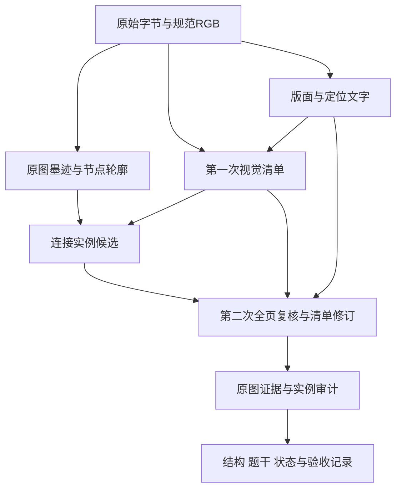

# 诊断后的架构决策

本文件是彻底修复开始前的设计依据。实现状态由后续验证报告记录；这里的计划不等于功能已经完成。

## 一、对象与不变量

1. 原始字节用于输入身份；EXIF方向和白底alpha合成后的RGB确定全部坐标。布局/检测/辅助图是带变换的派生视图。
2. 页面区域、数学面板、数学节点、节点轮廓、像素线段、连接实例、文字区域分别存储。它们之间允许一对多和多对一，不能用同一个连通分量 ID 混用。
3. 坐标协议始终是完整规范原图的0–1000；工作图缩放只在边界转换。显示截图、拼图坐标不能进入拓扑数据。
4. 接受一条边需要独立实例、合法端点、原图线迹支持和明确属性；像素命中与模型自洽均不是独立正确性证书。
5. 保留多个连通分量、孤立节点、自环、同向平行边、反向弧与无向边。不得按图名、度数、连通性先验补线或删除节点。
6. 一次图形识别最多两次 `qwen3-vl-plus` 发送，自动重试0；DeepSeek文字校正另外计数。失败后不启动旧视觉链。

## 二、图像与CPU模型

布局继续使用受限尺寸副本；文字检测显式设置 longest-side/max，首选1280作为待实测配置。检测框映射回原图后，文字识别使用原图裁片。禁止先全局缩小原图再声称保留全分辨率文字。

worker继续串行运行，保留1600MiB RSS、768MiB余量与4GiB应用预算；不是通过扩大内存上限“修复”。记录每次original/enhanced pass的det与rec开始/结束、检测输入大小、框数量、峰值是否观测到。日志不要包含题干明文或凭据。

若1280检测在细字上造成漏检，须凭全量实测选择1600或有界局部检测；不能自动无限切片、多次远端调用或不断重试。不同参数方案的结果不能挑优拼成一次通过。

## 三、节点几何与连接实例

节点 geometry 应包含中心、外轮廓/半轴、类型、置信度及证据。候选圆周应允许中心小偏差和椭圆，但必须综合面积、外圈覆盖、轮廓连续性与内部字形，避免把数字内部孔当节点边界。无法测量时用保守回退并保留不确定性。

出线端口是路线与节点外边界的交点/方向扇区。路线在节点区域内无需沿墨迹走到中心，但节点外的线迹必须独立验证。第三节点穿越、交叉转向和自环判断使用相同几何模型，避免各模块各猜一个半径。

线段续接依据局部切线、间隙、颜色和端口构成候选。虚线只对完整的中间间隔统计，不把截断端点当周期。连接实例保留稳定ID，只有同一真实墨迹的重复路线才冲突；反向弧不能被无序端点合并。空心箭头外轮廓是否属于同一连接仍需实例复核，不能仅以轮廓数计边。

## 四、两次视觉请求与可修订面板

第一次建立暂定面板、节点、题干及不确定性。CPU利用此清单产生路径候选。第二次同时收到完整原图、全部面板裁图、定位文字和候选；再次确认页面是否遗漏子图。

第二次允许两类纠正：

- 小范围纠正：原图ID保留，显式更新节点/图名/边界，原有候选身份不变。
- 面板修订：显式列出被替换的旧面板、完整的新面板、旧节点到新节点的来源映射，以及不能迁移的候选处置。新增、拆分、合并均走这一协议。旧候选按来源加命名空间，端点只通过显式节点映射迁移，不能偷换成另一条平行线。

任何旧节点或候选未被保留、明确删除或处置，清单都不能complete。修订后的每个面板仍需覆盖所有节点reads和全部候选verdicts；新发现边给新ID且检查原图路径。首轮不确定可在第二轮明确修订/确认后解除，不能永久锁死，也不能被无解释的true抹掉。

新增面板在第二次仍有完整原图可读，但不可能再获得第三轮CPU候选提示；其边只能由本轮原图路径和本地审计确认。这个限制必须保留，不能伪称两次限制下没有任何检出上限。

## 五、题干证据

Paddle区域文字与视觉题干各自保存。依据最终面板归属重新过滤图内节点/边标签，禁止用全局正则删除数字。第二轮可输出明确的题干复核结果，并解释定位证据中的关键字符冲突。

数字、变量、上下标、运算符差异属于内容冲突，不能由DeepSeek润色无痕覆盖。没有明确复核时保持partial。关键字符一致只是必要条件，不是全文正确的证明。截断原题干不能由模型补造。

## 六、状态与单遍证书

服务可用性、阶段执行状态、整题完整性分别记录。文字memory_limit不叫公式降级；有部分结果时可以展示，但ready/complete不能虚报。透明图预览固定白底，与后端一致。

验收证书必须绑定原图hash、起止源码hash、输入顺序、每图一次attempt、两个Qwen发送记录与模型metric、DeepSeek独立记录、原始响应、人工参考版本及前端响应hash。完整两阶段结果要求两个成功Qwen发送；失败可在第一阶段结束，但不得获完整证书。合成UI测试与候选隔离报告不能替代原图证书。

参考有疑问的样本单独标记不可认证，保留识别输出用于诊断。最终目标仍是全部原图单遍正确；缺失像素或题干需要更清晰原件，不允许将猜测写进答案或模型提示。

## 七、部署与变更边界

不合并主分支、不改生产配置、不部署Zeabur；以独立开发分支提供可审查变更。目标Docker环境必须通过实际2CPU/4GiB资源门禁。优先采用现有OpenCV/Paddle轻量算法，不新增GPU网络。论文或README的模型大小、GPU延迟不能换算成当前CPU RSS或吞吐。

各修复只在明确归属的模块实施：OCR模型与资源、节点/路径几何、面板/文本协议、应用/前端/评测。每个模块有针对已复现故障的验证；完成后统一冻结源码并重新执行必要的全量门禁。

## 八、实现阶段的实测决策补充

保留以上修复前设计记录。1280与1600的独立诊断探针显示不同字符仍有分歧，不能将输出框数解释为准确率。最终选定文字检测1600/max，检测框映回规范原图后裁字，original/enhanced最多两遍本地处理，未采用增强候选保留为uncertain。固定参数的53张v3运行中两个本地阶段全部执行成功，未发生超限或重试；完整内容正确性仍待双次Qwen和独立参考验证。

无图DeepSeek的职责进一步收紧为明确等义字形与空白规范化；实质正文更改均须原图复核并解释冲突。原因是独立反例证明仅保护数字、符号或有限中文词表仍可漏过颜色、指令、关系和组合编辑。最终对单项与组合后全文使用同一内容签名约束，不能按文章上下文猜原文。
