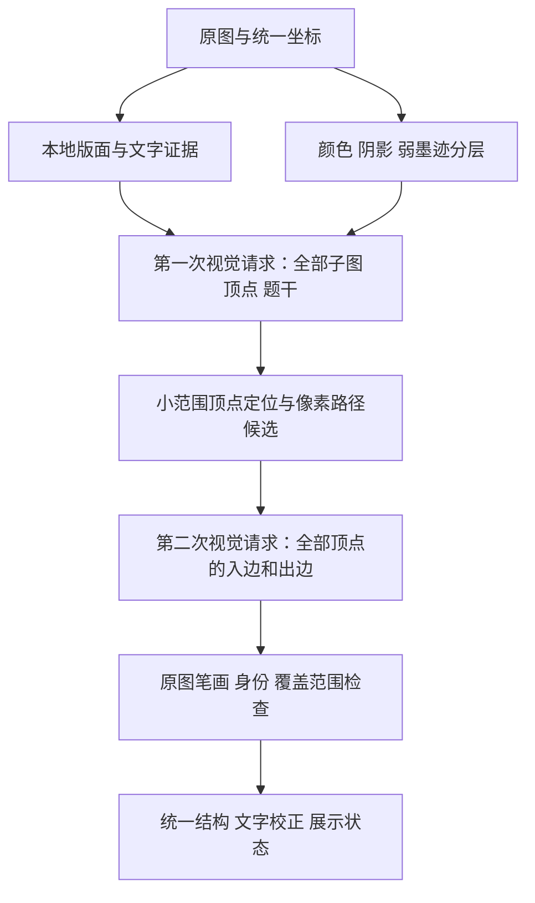

# 图论识别重构：原图证据、两次视觉请求、单遍验收

## 状态与代码基线

这是开发分支的实现说明，不能作为“全部真实图片识别正确”或生产发布的证明。

本文描述已实现的固定流程。用户后来明确要求 DMate 应用内的工具插件和子智能体协作，
新增设计见 [工具与子智能体架构](DMATE_TOOL_AGENT_ARCHITECTURE_20261026.md)。
下面的两次调用预算属于此基线实现，不是新架构必须沿用的永久约束。

本次同时保留两个已有分支的工作：`codex/graph-ocr-nextgen-20261022` 的 `4dc73f96d91949c9388500014e56c179636c054a`，以及 `codex/graph-review-fixes-20261026` 的 `c2310abcd70d72fe1150eed81bbbecca2468c458`。它们从共同祖先分叉，后者只有一个新提交，不能覆盖前者独有的 24 个提交。合并保留稳定候选身份修复、原有模块、原有展示和测试。

开发默认入口为 `recognize_graph_document(..., graph_pipeline='evidence-two-pass')`，版本为 `2026-10-26-evidence-two-pass-v3`。旧 `qwen-simple-candidate` 与 `staged` 保留作历史对照；本次实际验收限定新流程。`/ocr` 进入新流程后的异常也已失败关闭，不会再启动旧视觉链。应用的 `DMATE_GRAPH_NEXTGEN` 开关由环境控制；用户已在部署环境开启，实际运行版本仍需健康接口与请求响应核对。

本轮诊断先于修改，根因与证据等级见 [全面诊断](GRAPH_COMPREHENSIVE_DIAGNOSIS_20261026.md)，修复前设计见 [架构决策](GRAPH_ARCHITECTURE_DECISIONS_20261026.md)。本文描述更新后的实现。

## 数据流



数学图、像素骨架和页面版面是不同的数据对象。一个数学图可以包含多个连通分量和孤立点；一个版面图框也可以包含多个数学子图。节点标签、边名和权值分别保存，不能从图名、度数或完全图模板倒推出缺边。

### 1. 图像与本地模型

`image_evidence.py` 解码原始字节，在建立坐标前应用 EXIF 方向，将透明像素按 alpha 合成白底。原始 RGB、工作 RGB、照明归一化图、轻量锐化图分别保存。墨迹证据来自未锐化图，不从恢复或锐化结果创造边。

默认输入上限 1600 万像素，证据工作图最长边 1600。全尺寸原图保留用于视觉输入和子图裁剪。所有节点、路径和子图框以原图坐标为唯一基准；模型协议固定为 0–1000，内部转换为 0–1，不猜坐标单位。

PP-DocLayoutV3 与 PP-OCRv6 Small 在独立子进程中串行加载，公式网络保持关闭。布局使用最长边2200的独立副本；文字使用规范原图，检测器显式1600/max，检测框映射后从原图裁字。一次请求内最多original/enhanced两遍本地文字处理，附阶段与RSS审计；增强中未被主结果采用的有效候选留在uncertain，不自动变成题干。文字框、图内标签候选、正文和图题都是待核对证据。版面模型运行成功但没有框，或把多图合并成一个框，不能代替数学子图清单。

### 2. 第一次视觉请求

固定使用 `qwen3-vl-plus`，输入完整原图和同坐标照明辅助图。返回全部子图、节点身份、原有标签、原图位置、图类型、题干转录及各自完整性。节点清单先于边清单，避免一次性猜出整幅图。

之后用 `graph_marker_grounding` 将既有清单关联到原图中有证据、相互唯一的标记中心，保留首轮坐标和定位依据。候选歧义或容量触顶时保留原位置；大空心圈与内部数字的小孔分别处理。再测量带置信度的节点轮廓与端口。中心、轮廓和数学节点身份是不同证据，定位器不增删或重命名节点，第二次视觉请求仍可以明确修正坐标，其更新不会再次被 CPU 自动覆盖。

### 3. 像素路径候选

沿用本地追踪器提出直线、曲线、重边和箭头候选。候选不是答案，也不继承视觉置信度。每条候选有独立 ID、端点和原图路径，第二轮必须明确接受、否定或保留不确定。

追踪器每批最多 10 图，新入口按批处理本地候选，因此第 11、12 图不会静默跳过。追踪器自身每图 30 节点、48 路径的限制仍存在，超过时产生明确诊断；所有节点仍进入第二次视觉请求。这个限制不能被解释为已完整覆盖复杂大图。

曲线模板对超过14个节点的面板跳过；其余节点对最多细化24个幅度假设，每个最多9次局部试探，最多保留4条曲线。拟合按真实中轴与原墨迹距离评分，避免粗采样网格改变相位后把真实弧线漏掉。实际轮廓/径向候选、曲线和路径上限记录于内部审计，并向第二轮提供容量提示；不把有限候选当作已穷尽的边清单。

Hough边界允许根据同一最近完整墨迹截面向中轴移动最多3像素，等距的独立平行段保持歧义。对齐是可选修正：先保存原来合法的节点附着，只有对齐后仍通过同一端口检查且端点身份不变才采用；否则保留原路径并记录回退原因。不会为了向更黑的邻线靠拢改变数学端点，也不降低原图支持阈值。

内部数字形成的小片墨迹必须与完整连通字形一致，不能把“4”的局部黑块当成独立实心节点。外圈被图像真实边界截断时，只对可见弧段计分，并要求足够弧长和方向分布；ROI裁小、贴边直线或短弧不能据此获圆环支持。图外不存在的像素不会成为新增边证据。

### 4. 第二次视觉请求

输入完整原图与全部子图、题干文字的原像素复核裁图。第二张图的拼接坐标不得进入返回结果。复核图采用紧凑布局，最长边2200、最多240万像素；文字仅在图像内容之外作元数据，OCR字符串不会绘入裁图或替代原字符。

模型对每个节点枚举全部入边与出边，同一实际笔画只用一个边 ID，各节点通过 ID 引用它；平行笔画使用不同 ID，自环只计一个边实例。必须覆盖所有子图、所有节点及全部像素候选。新边使用合法、图内唯一的 ID 和原图路径，不要求 `new_` 前缀；通过可选 `candidate_id` 显式绑定既有候选，不能偷换端点或重复绑定。输出边 ID、印刷边名和候选 ID 分别保存。节点纠错通过显式的新增、删除、更新记录完成。

第二轮也可修订面板。小改动用panel_update；新增、删除、拆分、合并用panel_revision，旧节点必须逐项映射或明确退役，候选只按旧端点来源迁移并保留独立身份。跨图或无法迁移的候选必须明确处置，不能静默消失。最终全部面板、全部节点和候选仍须复核。原图像素中没有的结构不能靠修订协议制造。

调用总数最多2，失败自动重试0；没有第三次补救调用，也没有跨供应商回退。视觉总预算140秒，每次最多75秒。第一轮输出上限10000 token，第二轮随节点、候选和定位文字增加，范围8000–16384 token；调用次数和时间限制不增加。官方模型支持更大的输出窗口不等于当前流程已验证所有大图。

### 5. 本地结构核对

`graph_stroke_checks.py` 检查路径端点、端点圆圈之外的独立墨迹、强弱笔画支持、断裂比例、是否穿过另一个真实顶点，以及交叉处是否错误转向。模糊或弱透印线保留为待确认，不能靠模型的 `complete=true` 抹掉不确定性。

相同端点不等于同一条边。去重先对齐极小的坐标误差，再检查原始墨迹走廊及白缝：单条粗线内部的两条路线应当冲突，白缝隔开的真实平行线应保留。自环还需要独立围合区域，不能把节点圆圈或同一条线往返记作自环。

粗略曲线仅能绑定到它自身稳定候选 ID 的实测路径，不能借用模型已经否定的另一候选。原图像素覆盖只是必要证据，不是充分的语义正确性证明；箭头方向、边名和权值仍需要真实模型及独立答案验收。

空心箭头采用两侧原始轮廓、共同尖端和肩部的实例证据，允许中轴为白色。该凭证必须与返回路径的中轴、空间受限端口、跨度和次序一致；同候选ID不能借凭证绕到空白区，也不能借用同端点另一条箭头。模型提供的轮廓元数据不替换CPU测量结果，头尾与方向冲突保留为pending。

`graph_schema.py` 保存独立边实例；NetworkX 用于一致性检查，不负责补边。任一子图漏复核、源顶点清单不闭合、边证据冲突、属性未知或题干未完整核对，都应进入待核对状态。

### 6. 文字与前端

两次视觉请求都复核题干，Paddle定位文字和原始转录保留作证据。第二轮须逐项给文字区域归属：body须出现在最终题干，graph_label须指向位置相符的最终面板，noise须说明排除依据，uncertain阻止完整认证。数字、变量、运算符、中文逻辑词等冲突需要明确原图依据，不能直接由某一个转录覆盖。

DeepSeek读取实际返回content，只接受有效的锚定edits。最终按完整内容签名复核，不依赖有限的中文关键词表：只允许明确等义字形（如奌→点）、NFC等义组合和保留词边界的空白规范化；普通实质改字必须交给原图视觉复核。Unicode上/下标、向量与上划线、数学字母、中文数词、颜色和逻辑词均不可由无图模型猜改。单项编辑通过后还复检组合后的全文，防止两个局部安全操作组合成题意变更，回滚时同步修正审计计数。非法结构、截断和拒绝改写与合法零改动区分。服务异常保留已复核图结构和原转录，返回partial。题干未完成时，图结构即使完整，整次结果也不能伪称完整。

前端继续显示白底原图预览和统一结构的文字卡片，透明图在深色主题下也与后端白底合成一致。无向边、有向边、独立重边、自环、权值、边名、虚线与待核对状态都来自同一套边记录。反向弧不算成同向平行边。前端不重绘图形，因此不能把文字卡片测试称为路径重绘验收。标签只在显示副本转义Markdown/HTML，原始数学标签保持不变。`/ready`分别报告本地阶段健康，不再把文字超限说成公式降级。

## 五个问题的具体落点

| 问题 | 已实现措施 | 仍需真实验收的条件 |
| --- | --- | --- |
| 颜色 | 保留 RGB，亮度/色差分开，兼容深色底和透明底 | 彩色细边、彩色节点及彩色背景的实际节点/边对应 |
| 透印 | 强弱墨迹分层，未确定浅线不删除；原图与辅助图分开 | 正面浅线与背面透印的逐条区分 |
| 模糊 | 质量诊断、有限辅助锐化、完整原图裁剪 | 已丢失的箭头/数字细节不能由增强伪造恢复 |
| 分图 | 版面只作提示；按数学图号/布局清点；全部面板参加复核 | 多分量图不能误拆，多个例图不能误合并 |
| 阴影 | 低频背景归一化；原图支持与弱墨迹分离 | 深阴影下的真实细线、桌面纹理和图书装饰的排除 |

## 资源故障修复

Paddle 导入前通过真实创建文件检查缓存根与子目录可写性，优先使用可用配置，失败才选择专属临时目录。使用官方 `PADDLE_PDX_CACHE_HOME`，不改系统 HOME。

保留 4 GiB 应用总预算、1600 MiB worker RSS 上限和 768 MiB 余量。cgroup 准入从总量中保守扣除干净、未映射文件缓存，保留共享内存、映射文件、脏页、回写、匿名内存和内核占用；统计不全时回退原有 inactive-file 计算。

旧 `RLIMIT_AS=3GB` 会将 Paddle 共享库映射等虚拟地址也计入，导致 RSS 约 916MB 时发生 MemoryError。改用 `RLIMIT_DATA=3GB` 约束私有数据，父进程继续监控真实 RSS 与 cgroup 工作集。没有通过提高生产机器配置掩盖错误。运行记录必须区分宿主限制、CPU 亲和性、应用保护和实际进程峰值；读不到 RSS 时必须记录未观测，不能报告为零占用成功。

## 分范围的严格单遍复验

`graph_first_pass_eval.py` 按子图名称/位置匹配，再按真实标签/节点位置一对一匹配，随后比较有属性的边实例多重集。内部任意 ID 不作为正确性依据；只比较边数不合格。方向、重数、自环、权值、边名、样式、题干及完整性都需对齐。

`scripts/benchmark_graph_first_pass.py` 保留原始响应和每图一次的记录，输出目录必须在仓库外且不能覆盖旧结果。记录Git SHA、起止源码指纹、原图SHA、实际网络发送和模型记录。v2管线通过要求恰好两次成功Qwen发送、finish_reason=stop、输入摘要/执行ID逐项对应，DeepSeek另记0或1次；不存在“有过调用就算通过”。标准答案只进入离线评测器，不得进入识别函数、提示词或按图查答案路径。

缺失凭据、未执行真实模型、参考图不清、前端未验证或源码中途变化都不能算通过。51张结构参考可认证，其中50张具有完整内容参考；2张结构/属性仍不清，另1张题干裁切，不能把猜测写成强制答案。每次实质修复后可以启动新的完整单遍，但不能从多轮结果中挑选每张最好结果拼成通过率。

首次响应的UI验收由`scripts/verify_graph_first_pass_ui.py`完成。它读取完整首次运行与相同manifest，核对原图、原始响应、执行身份和全源码快照，在真实Chromium中分别重放桌面与手机对话框，检查全部面板、节点、边实例和题干。它阻断并记录所有新增OCR及外网请求，只追加前端证据和合并后的结果，不覆盖首次识别记录。不得用旧预检、仅本地OCR结果或合成数据替代真实首次运行。

上述入口的范围严格限定：`--local`直接执行识别管线，弹窗工具直接重放首次响应；它们没有从浏览器文件选择入口走完整`/ocr`流程。`execution_mode`仅允许local/http，明确保留`pipeline_status`、`frontend_status`、`pipeline_ui_status`及各自计数。本地`application_status=not_run`；HTTP实际有响应时保留状态码和响应计数，但完整应用仍为`not_certified`。当前两个工具的`certified_passes`及`application_certified_passes`固定为0，不能用调用者填写的声明升级范围。完整应用还需要实际上传、路由/配置、响应及就绪状态的独立验证。

```bash
python scripts/verify_graph_first_pass_ui.py \
  --run /private/frozen-first-pass-run \
  --manifest /private/manifest.json \
  --browser /private/chromium/chrome \
  --cdn-cache /private/verified-public-js-cache
```

冻结本地OCR v3已在53张原图上逐张执行一次：布局53/53、文字53/53阶段成功；文字峰值1283.328MiB，布局峰值1121.355MiB，总耗时897.982秒。阶段记录106/106均实际观测RSS。这一结果证明此前本地资源故障得到修复，不证明节点、方向、属性或题干全部正确。宿主为8CPU/8GiB，运行使用2CPU亲和性及4GiB软件预算；真实2CPU/4GiB容器仍必须由Docker资源门禁独立测量。

研究来源和逐项采用边界见 [GRAPH_RECOGNITION_RESEARCH_20261026.md](GRAPH_RECOGNITION_RESEARCH_20261026.md)。

补充官方依据：

- [Qwen3-VL-Plus 模型输出窗口](https://help.aliyun.com/zh/model-studio/qwen3-vl-plus)
- [Qwen 结构化输出](https://help.aliyun.com/zh/model-studio/qwen-structured-output)
- [Linux cgroup v2 内存统计语义](https://docs.kernel.org/admin-guide/cgroup-v2.html)

