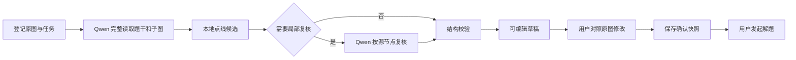

# 图片与图形识别

本页说明当前代码如何接收原图、生成可编辑草稿，以及把用户确认后的内容交给解题。接口字段见 [API](API.md)，其他模块见 [系统架构](ARCHITECTURE.md)。

## 先分清五种内容

| 内容 | 来源与作用 | 不代表什么 |
| --- | --- | --- |
| 原图 | 用户实际上传的字节，服务端计算 SHA-256 绑定来源 | 不因模型输出而改变 |
| 首次识别快照 | 自动扫描得到的题干、子图与结构；前端称“原生识别” | 不是人工已经核对的真值 |
| 选区来源 | 用户在原图中圈出的文字或图形区域，各自识别并维护版本 | 不自动与原生快照混合 |
| 当前文档 | 当前模式下实际选出的 `body_text` 与 `graphs` | 不等于画面上所有曾经识别过的内容 |
| 确认语义快照 | 用户保存后，经过结构校验并绑定来源、修订号的解题输入 | 不认证与原图完全一致，也不认证解题答案 |

识别、核对、发送与解题是不同动作。“保存”生成确认快照并关闭编辑窗口；“发送”才创建题目消息和 AI 请求。当前网页核对窗口主要通过重选区域及组合来源更正输入，结果区本身不是自由文本或 JSON 编辑器；独立绘图窗口则提供节点与边的直接编辑。

## 入口决定实际流程

`POST /ocr` 的 `workflow` 字段直接决定路由：

| 请求方式 | 实际入口 | 行为 |
| --- | --- | --- |
| `workflow=auto_graph` | `graph_qwen_targeted.recognize_qwen_targeted` | 当前网页自动识图；生成草稿并按需局部复核 |
| `workflow=manual_graph` | `app.py` 手工分支 | 登记原图并返回空白图草稿，不启动文字 OCR 或模型 |
| 未指定，默认 nextgen + `agent-tools` | `ocr_nextgen.py` → `graph_fast_pipeline.recognize_fast` | 兼容快速识别，使用另一套模型与本地工具编排 |
| nextgen + `evidence-two-pass` | `graph_evidence_pipeline.py` | 显式选择的兼容双阶段流程 |
| `DMATE_GRAPH_NEXTGEN=0` | `ocr.py` 和 `ai.py` 等旧路径 | 本地 OCR、公式识别与兼容图片理解 |

`ocr_nextgen.py` 还支持供显式调用方使用的 staged、simple 和 strict 路径。`agent-tools-strict` 才调用 `graph_agent_pipeline.py`；它不等于网页的 `auto_graph` 或默认 `agent-tools`。

网页在 `static/script.js` 中为上传图片明确写入 `workflow=auto_graph`。因此，修改兼容管线的默认模式，不能推断网页自动扫描也已切换。网页中的“原生识别 / 自主框选”是前端信息来源模式，也不等于 `/ocr` 的 `manual_graph` 路由。

## 当前自动识图

主读和复核均固定使用 `qwen3.8-flash`，开启 thinking，thinking budget 为 4096。此流程最多两次视觉调用：第一次读完整原图，第二次只在本地证据产生复核计划时调用；不自动切换模型提供方。文字也由这次视觉读取获得，不再串行调用 PaddleOCR、DeepSeek 或 GLM 整理题干。

第一阶段按原图读取题干、全部小问、独立子图、节点、边、箭头、权值、独立边名和外观描述。节点的内部 `id` 与印刷 `label` 分开；无名节点的 `label` 为 `null`，界面可分配临时 `display_label`。权值 `weight` 与独立边名 `edge_label` 分开。平行边、自环分别保存为独立边，交叉线不自动产生节点。

本地 OpenCV 工具检查部分草稿的节点位置与线迹。候选只提出需要核对的位置，不能直接证明图中存在某条边。当前工具限制候选图数量和节点总量，未检查的子图会记录在诊断中。若草稿把实际相连的区域拆为两图，限定的跨区域检查可发起共同复核；只有视觉复核满足合并条件才重新归组。

复核请求结合完整原图与原像素局部图，按源节点检查指定端点组。合并只允许修改计划涉及的范围；待复核端点对超过 16 组时保留现有草稿并提示用户核对，不无限追加模型调用。工具或复核失败时尽量保留已读草稿，附带未完成原因。

最后通过 JSON Schema、端点身份和 NetworkX 等程序检查。`recognition_status=complete` 表示当前工作流没有记录未处理问题，不能证明与原图完全一致；`partial` 表示仍有疑点或阶段未完成；路由无法得到草稿时返回失败。两种草稿状态都需要用户核对后保存，才可交给当前图片解题流程。

### 图形字段的含义

| 字段 | 含义 | 使用时的约束 |
| --- | --- | --- |
| `body_text` | 原图中的题干、条件、公式及小问 | 没有题干时保持为空，不根据图编造问题 |
| `graphs[].id` | 当前文档中的子图身份 | 同一文档内不能重复；多图合并后还要隔离不同图片的 ID |
| `vertices[].id` | 边端点引用的稳定内部身份 | 与原图印刷标签分开，不随显示编号改写连边 |
| `vertices[].label` | 原图可读的顶点标签 | 无名节点用 `null`，不把 `v1` 假装成原图文字 |
| `display_label` | 供核对时引用的临时编号 | 只在当前子图内有效 |
| `x`、`y` | 相对整张方向校正后原图的近似坐标 | 用于定位和叠加展示，不能代替端点身份 |
| `position_description` | 顶点相对本图的位置描述 | 应区分内外圈、上下排和同侧多个点 |
| `visual_description` | 原图位置、布局、线条画法等可见外观 | 不写图名猜测、同构结论或答案 |
| `edges[].from`、`to` | 当前子图内的端点 ID | 有向边按箭尾至箭头记录，端点必须存在 |
| `direction` | `undirected`、`forward` 或识别草稿中的 `unknown` | 未知可以保留在草稿，但确认前须处理 |
| `weight` | 该边的权值 | 与边名分开，无权值时为空 |
| `edge_label` | 原图独立印刷的边名 | 不能为凑字段自动生成，也不能重复抄入同一权值数字 |
| `path` | 曲线 / 折线的可见路径 | 属于几何展示信息，不能由路径交叉凭空增加顶点 |

例如一条边旁只有数字“200”，可以是 `weight: 200`、`edge_label: null`；只有看见另一个独立印刷的边名，才同时填写二者。孤立点必须保留，每条平行边和每个自环都应独立记录，不能为了得到常见图形而删改。

## 文件、传输和时间边界

单张上传文件最多 **20,000,000 字节**。一般原图解码像素总量最多 `7680 × 4320`，这是像素数量上限，并非分别约束宽和高。Flask 请求体另预留 2,000,000 字节选区 JSON 与 512 KiB multipart 开销。

原图按 EXIF 校正方向后用于选区、编辑和模型输入。发送 Qwen 的 Data URI 也限制为 20,000,000 字节：优先 PNG，过大时对发送副本逐级改用 JPEG；此编码不缩小尺寸，但有损压缩仍可能影响细节。原图摘要始终根据实际上传字节计算。

自动识图的服务端性能目标为 120 秒；诊断分别记录是否在目标内、是否完成、是否包含浏览器渲染。当前目标统计不包含浏览器渲染。操作预算默认 200 秒、单次远程调用上限 80 秒；路由还设有外层截止时间。它们是代码边界，不是完成时间承诺。

活动原图任务使用进程内 `UPLOAD_TASKS`，容量为 4；同一浏览器同一活动请求重复提交返回 409，容量满返回 429。网页可提交多张图片，但每张分别上传、识别、编辑和确认，最多将 4 张已确认图片组合发送。

`/ocr/cancel` 按当前浏览器与请求 ID 登记取消标记，工作流在检查点停止继续处理。选区重识别使用自己的 `operation_id` 取消。接口返回 `cancelled: true` 表示取消标记已接收，不表示已发送的远程 HTTP 请求或提供方推理已经终止。活动任务、取消标记与限流未跨进程共享。

前端超时、反向代理超时、服务端操作预算和提供方超时是不同边界。只看到浏览器结束等待，不能断言提供方未计费；同样，超过性能目标但仍在预算内的任务，不等于已经失败。遇到慢任务时可以取消，不应通过无间隔重传反复创建识别请求。

## 手工选区与编辑

- `/graph/text-region`：只对用户选中的原像素做本地文字 OCR。多选区按 `order` 排序，旧格式按编号排序；未选像素在送给 OCR 前被遮白。
- `/graph/recognize-region`：只重新识别选中的图形区域，得到的坐标映射回原图。
- `/graph/figure-type`：只扫描所选区域的方向与权值类型，不创建节点、边或路径；未识别清楚时保留未知。
- `/drawing/upload`：上传画板导出的 PNG 和已有结构，校验后登记为新的来源，不通过模型重新读图。

选区接口必须携带已登记的 `request_id` 和同一原图。选区坐标使用方向校正后的原图坐标系，范围为 0–1；多边形最多 64 个点。原图字节变化或浏览器来源身份不符时，服务端拒绝引用旧任务。

### 前端来源组合与异步结果

`static/graph-scan-workspace.js` 将 `nativeDocument`、`textRegions`、`graphRegions` 分开管理：

1. 原生模式只输出 `nativeDocument`，自主模式的选区结果不会回写它。
2. 自主模式只组合 `selected !== false` 的来源；新框明确设为 `selected: false`，需要用户勾选。
3. 文字来源按列表顺序以空行拼接，图形来源按列表顺序展开；图形选区中的子图 ID 以来源 ID 区分。
4. 移动或调整选区后增加来源版本，清空该范围的旧结果，再排队重识别。
5. 返回时核对来源仍存在、版本仍一致、编辑器未销毁，迟到结果不能覆盖已经调整或删除的框。
6. 保存时检查所选来源；正在排队、识别中、失败或为空的来源不能组成可确认的文档。存在部分结果时仍会展示待核对原因，服务端确认还要检查实际语义问题。
7. 关闭编辑器会中断其活动请求，但当前页面的选区状态保留在图片任务中；再次打开继续使用该任务状态。刷新页面不提供任务恢复保证。

文字框与图形框有各自的“选择信息”列表。取消勾选只影响本次组合，删除来源则需确认。原生题干不会在自主模式自动补齐；只选择图形来源会得到没有原生题干的组合，这属于明确的来源选择结果。

图形选区重新调用图形识别服务，并将坐标映射回原图；文字选区走本地 OCR。调整文字框不意味着再次对整张图片运行视觉模型。`/graph/figure-type` 保留为类型识别接口，不能把它的成功结果当成已经获得完整节点和边表。

### 独立绘图是另一种来源

`static/drawing-workspace.js` 使用已有画板结构生成 PNG，经 `/drawing/upload` 注册来源，返回文档和原图摘要。前端将其作为 `workflow_profile=user_drawing` 的图片任务加入同一核对 / 分组 / 发送流程。

这条路径使用用户画出的顶点和边，不让模型从导出 PNG 重新猜一次连边。绘图用的实时坐标可生成位置和外观描述；这些描述来自实际画面，不是原图视觉证据。登录账号的图库保存在本机，游客绘图只留在当前页面内存；图形上传成为聊天输入后，才按对应对话和同步规则处理。关闭并重开绘图弹窗可继续当前页面的游客画板，刷新或关闭网页则清空，不从旧版游客持久图库恢复。

## 确认与解题

`/graph/confirm` 接收编辑后的完整文档，拒绝重复 ID、无效端点、未知方向和仍未处理的疑点。校验通过后，SQLite 保存来源、文档和确认令牌的摘要、修订号与到期时间，不保存原图或完整题干。记录默认有效期为 7 天。

响应同时返回完整语义快照、绘图文档和 `semantic_context`。前端用它们展示并提交解题；语义快照与绘图坐标分别保留。`/chat` 核对确认状态，旧修订号、修改后的内容或另一浏览器的令牌会被拒绝。多图逐张校验后隔离图 ID，避免不同原图中同名节点、子图混淆。

确认只说明用户确认了这份输入且程序检查通过；不会把识别结果变成原图准确率认证。解题工具根据确认后的结构计算，不能用答案倒推并改写原图结构。

### 一次确认如何绑定到一次解题

确认记录按当前浏览器来源身份与 `request_id` 区分，保存 `source_sha256`、文档摘要、确认令牌摘要、修订号与到期时间。再次保存同一任务会增加修订号并更换令牌，旧快照不能继续冒充新确认。

`semantic_context` 携带完整确认文档及对应的题目展示文本。`/chat` 重新计算文档摘要，核对令牌、原图摘要、任务、修订号以及题目文本。以下情况应重新核对，而不是绕过检查重试旧令牌：

- 内容已变更，但仍携带原来的确认信息；
- 同一任务再次保存后，发送旧修订号；
- 换成另一张原图，却沿用原任务 ID；
- 在另一个浏览器来源中复用确认令牌；
- 确认记录已到期，或本地确认存储被清除。

确认令牌不是账号密码或通用 API 密钥，仍不应对外分享。SQLite 只记录校验所需摘要与身份元数据，完整快照由响应返回前端，并随实际解题请求提交；它不能被当作题库、原图长期存储或跨浏览器草稿同步服务。

### 多图分组与要求传递

前端最多保留 4 张当前图片，逐张确认后按组构造消息。每组拥有自己的确认上下文列表、用户消息与解题请求；同组图片按上传顺序引用，不同组分开回答。所有图片确认和所有组长度检查通过后，才开始第一组解题。

每张图片的可选要求来自用户填写的 `userRequest`，还可加上本次主输入框的共用要求。只有实际存在这些内容时，展示消息才添加“【我的要求】”，请求才增加本轮要求区块；留空时直接使用确认后的题目，不生成默认要求。组内“图片 1 / 图片 2”是当前组的局部编号。

组内任一成员的 `isQuestion` 为真，该组按一道正式题目记录；全为假时只作为问答。该标记与文字输入框的手动题目标记分开，不用图片组号替代会话题号。

开始发送后，前端立即切回普通聊天输入区并保留红色停止按钮；原图和任务仍保留到对应组成功回答。失败或停止后，未完成组回到图片工作区；成功组已被移除，不随重试再发送。内容未变的重试复用原用户消息；修改题干或图结构需要重新确认，修改补充要求或分组也会产生新的提交内容。

### 程序计算的边界

结构检查可以发现无效端点、重复身份、未确定方向、无效图注引用等问题；解题阶段可以对已确认结构使用本地数学工具。工具结论的前提是输入的结构与题意正确，不能从“边数合法”“图可以建立”推断“原图读取无误”。

涉及同构、欧拉性质、连通性、最短路径等结论时，必须分别核对算法的适用图类型与输入完整性。有向 / 无向、重边、自环和权值读错，都可能使一个程序执行正确的计算给出错误题目的答案。知识解释和未覆盖题型仍依赖模型，不能把本地校验表述为对所有离散数学答案的形式化证明。

## 本地 OCR 与兼容路径

文字选区使用 `ocr_runtime.py` 的有界子进程。缓存中使用 `PP-OCRv6_small_det`、`PP-OCRv6_small_rec`；需要版面分析的流程可使用 `PP-DocLayoutV3`。运行时分别记录实际执行、跳过、超时或资源不足，模型缓存由镜像构建流程预先准备。

未显式选择网页工作流的默认 `agent-tools` 通过 `graph_fast_pipeline.py` 使用 `qwen3-vl-plus`，有具体争议时可调用 `glm-5v-turbo` 复核，并有该路径自身的受限重试与降级条件。旧 OCR/公式路径仍保留 `PP-FormulaNet_plus-S` 等实现。它们与当前 `auto_graph` 的模型调用、时间预算和完成含义应分别判断。

诊断字段记录实际模型调用、工具执行、复核范围、程序校验和性能。检查问题时应先核对请求的 `workflow` 与响应的 `workflow_profile`、`diagnostics.workflow_version`，再定位具体阶段。不要以某个工具成功、历史识别记录或健康接口返回成功推断整张图片已经识别正确。

## 排查顺序

| 现象 | 首先查看 | 处理方向 |
| --- | --- | --- |
| 整图有题干，但自主模式没有文字 | 当前模式、文字来源勾选与状态 | 补框并选择文字来源，不自动混入原生结果 |
| 单个框识别后没有汇入文档 | `selected`、来源状态与列表顺序 | 新框需勾选；失败 / 空结果需重选范围 |
| 调整选区后显示旧内容 | 来源版本及前端活动请求 | 检查迟到结果保护；以新范围结果为准 |
| 图中节点位置或外观缺失 | 当前文档的坐标与描述字段 | 区分原图扫描缺失与绘图派生信息，不能凭拓扑编画法 |
| `409` 来源或确认错误 | 浏览器身份、任务 ID、摘要、修订号 | 从当前原图重新确认，来源失效时重新登记 |
| `429` | 任务容量与识别限流 | 减少并发、等待后重试，不持续自动重传 |
| `503` 或阶段超时 | 实际失败阶段、模型配置、本地 OCR 缓存及资源 | 先修复该服务 / 资源问题，不认定为“图片没有文字或图” |
| `partial` | `review.reasons`、未确定端点 / 箭头和工具执行状态 | 对照原图核对，不将部分草稿当作完整认证 |
| 停止后远端仍有调用记录 | 取消标记与远端请求已经发出的时间 | 取消只保证本地停止继续等待 / 后续阶段，不能撤回已经开始的推理 |

维护时优先使用本地静态检查与不调用模型的定点验证；确需真实识别请求时，应先明确使用哪条工作流及其远程调用成本。仓库中的旧测试、基准和历史诊断页面已清理，不应把旧流程的结果或数字当作当前实现的准确率报告。
