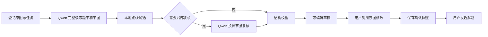

# 图片与图形识别

本页说明当前代码如何接收原图、生成可编辑草稿，以及把用户确认后的内容交给解题。接口字段见 [API](API.md)，其他模块见 [系统架构](ARCHITECTURE.md)。

## 入口决定实际流程

`POST /ocr` 的 `workflow` 字段直接决定路由：

| 请求方式 | 实际入口 | 行为 |
| --- | --- | --- |
| `workflow=auto_graph` | `graph_qwen_targeted.recognize_qwen_targeted` | 当前网页自动识图；生成草稿并按需局部复核 |
| `workflow=manual_graph` | `app.py` 手工分支 | 登记原图并返回空白图草稿，不启动文字 OCR 或模型 |
| 未指定，默认 nextgen + `agent-tools` | `ocr_nextgen.py` → `graph_fast_pipeline.recognize_fast` | 兼容快速识别，使用另一套模型与本地工具编排 |
| nextgen + `evidence-two-pass` | `graph_evidence_pipeline.py` | 显式选择的兼容双阶段流程 |
| `DMATE_GRAPH_NEXTGEN=0` | `ocr.py` 和 `ai.py` 等旧路径 | 本地 OCR、公式识别与兼容图片理解 |

`ocr_nextgen.py` 还支持供显式调用方使用的 staged、simple 和 strict 路径。`agent-tools-strict` 才调用 `graph_agent_pipeline.py`；它不等于网页的 `auto_graph` 或默认 `agent-tools`。

## 当前自动识图

主读和复核均固定使用 `qwen3.8-flash`，开启 thinking，thinking budget 为 4096。此流程最多两次视觉调用：第一次读完整原图，第二次只在本地证据产生复核计划时调用；不自动切换模型提供方。文字也由这次视觉读取获得，不再串行调用 PaddleOCR、DeepSeek 或 GLM 整理题干。

第一阶段按原图读取题干、全部小问、独立子图、节点、边、箭头、权值、独立边名和外观描述。节点的内部 `id` 与印刷 `label` 分开；无名节点的 `label` 为 `null`，界面可分配临时 `display_label`。权值 `weight` 与独立边名 `edge_label` 分开。平行边、自环分别保存为独立边，交叉线不自动产生节点。

本地 OpenCV 工具检查部分草稿的节点位置与线迹。候选只提出需要核对的位置，不能直接证明图中存在某条边。当前工具限制候选图数量和节点总量，未检查的子图会记录在诊断中。若草稿把实际相连的区域拆为两图，限定的跨区域检查可发起共同复核；只有视觉复核满足合并条件才重新归组。

复核请求结合完整原图与原像素局部图，按源节点检查指定端点组。合并只允许修改计划涉及的范围；待复核端点对超过 16 组时保留现有草稿并提示用户核对，不无限追加模型调用。工具或复核失败时尽量保留已读草稿，附带未完成原因。

最后通过 JSON Schema、端点身份和 NetworkX 等程序检查。`recognition_status=complete` 表示当前工作流没有记录未处理问题，不能证明与原图完全一致；`partial` 表示仍有疑点或阶段未完成；路由无法得到草稿时返回失败。两种草稿状态都需要用户核对后保存，才可交给当前图片解题流程。

## 文件、传输和时间边界

单张上传文件最多 **20,000,000 字节**。一般原图解码像素总量最多 `7680 × 4320`，这是像素数量上限，并非分别约束宽和高。Flask 请求体另预留 2,000,000 字节选区 JSON 与 512 KiB multipart 开销。

原图按 EXIF 校正方向后用于选区、编辑和模型输入。发送 Qwen 的 Data URI 也限制为 20,000,000 字节：优先 PNG，过大时对发送副本逐级改用 JPEG；此编码不缩小尺寸，但有损压缩仍可能影响细节。原图摘要始终根据实际上传字节计算。

自动识图的服务端性能目标为 120 秒；诊断分别记录是否在目标内、是否完成、是否包含浏览器渲染。当前目标统计不包含浏览器渲染。操作预算默认 200 秒、单次远程调用上限 80 秒；路由还设有外层截止时间。它们是代码边界，不是完成时间承诺。

活动原图任务使用进程内 `UPLOAD_TASKS`，容量为 4；同一浏览器同一活动请求重复提交返回 409，容量满返回 429。网页可提交多张图片，但每张分别上传、识别、编辑和确认，最多将 4 张已确认图片组合发送。

`/ocr/cancel` 按当前浏览器与请求 ID 登记取消标记，工作流在检查点停止继续处理。选区重识别使用自己的 `operation_id` 取消。接口返回 `cancelled: true` 表示取消标记已接收，不表示已发送的远程 HTTP 请求或提供方推理已经终止。活动任务、取消标记与限流未跨进程共享。

## 手工选区与编辑

- `/graph/text-region`：只对用户选中的原像素做本地文字 OCR。多选区按 `order` 排序，旧格式按编号排序；未选像素在送给 OCR 前被遮白。
- `/graph/recognize-region`：只重新识别选中的图形区域，得到的坐标映射回原图。
- `/graph/figure-type`：只扫描所选区域的方向与权值类型，不创建节点、边或路径；未识别清楚时保留未知。
- `/drawing/upload`：上传画板导出的 PNG 和已有结构，校验后登记为新的来源，不通过模型重新读图。

选区接口必须携带已登记的 `request_id` 和同一原图。选区坐标使用方向校正后的原图坐标系，范围为 0–1；多边形最多 64 个点。原图字节变化或浏览器来源身份不符时，服务端拒绝引用旧任务。

## 确认与解题

`/graph/confirm` 接收编辑后的完整文档，拒绝重复 ID、无效端点、未知方向和仍未处理的疑点。校验通过后，SQLite 保存来源、文档和确认令牌的摘要、修订号与到期时间，不保存原图或完整题干。记录默认有效期为 7 天。

响应同时返回完整语义快照、绘图文档和 `semantic_context`。前端用它们展示并提交解题；语义快照与绘图坐标分别保留。`/chat` 核对确认状态，旧修订号、修改后的内容或另一浏览器的令牌会被拒绝。多图逐张校验后隔离图 ID，避免不同原图中同名节点、子图混淆。

确认只说明用户确认了这份输入且程序检查通过；不会把识别结果变成原图准确率认证。解题工具根据确认后的结构计算，不能用答案倒推并改写原图结构。

## 本地 OCR 与兼容路径

文字选区使用 `ocr_runtime.py` 的有界子进程。缓存中使用 `PP-OCRv6_small_det`、`PP-OCRv6_small_rec`；需要版面分析的流程可使用 `PP-DocLayoutV3`。运行时分别记录实际执行、跳过、超时或资源不足，模型缓存由镜像构建流程预先准备。

未显式选择网页工作流的默认 `agent-tools` 通过 `graph_fast_pipeline.py` 使用 `qwen3-vl-plus`，有具体争议时可调用 `glm-5v-turbo` 复核，并有该路径自身的受限重试与降级条件。旧 OCR/公式路径仍保留 `PP-FormulaNet_plus-S` 等实现。它们与当前 `auto_graph` 的模型调用、时间预算和完成含义应分别判断。

诊断字段记录实际模型调用、工具执行、复核范围、程序校验和性能。检查问题时应先核对请求的 `workflow` 与响应的 `workflow_profile`、`diagnostics.workflow_version`，再定位具体阶段。不要以某个工具成功、历史识别记录或健康接口返回成功推断整张图片已经识别正确。
